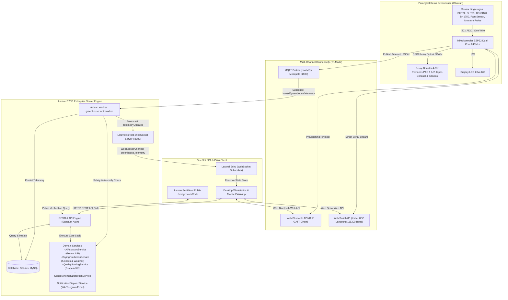

# 🌾 Smart Room Dryer Hanjeli — IoT Greenhouse Monitoring & Control System

Panduan production Docker (PHP 8.4, MySQL 8.4, Reverb, MQTT, queue dan scheduler): [Deployment Ubuntu](docs/deployment/docker.md). Deployment production tetap manual; workflow GitHub Actions menjalankan CI dan validasi Docker terisolasi.

<p align="center">
  
  &nbsp;&nbsp;&nbsp;&nbsp;&nbsp;&nbsp;&nbsp;&nbsp;
  
</p>

<p align="center">
  <strong>Sistem Cerdas Otomasi dan Pemantauan Pengeringan Biji Hanjeli Berbasis Agro-Industrial IoT, WebSockets Real-Time, dan Web Bluetooth (BLE)</strong><br>
  <em>Dikembangkan oleh <a href="https://github.com/fatintsani"><strong>@fatin_tsani</strong></a> dari <strong>CoE STAS-RG</strong> untuk Program Pengabdian kepada Masyarakat di Desa Wisata Hanjeli (Jl. Pamoyan, Waluran Mandiri, Kec. Waluran, Kabupaten Sukabumi, Jawa Barat 43175, Indonesia)</em>
</p>

<p align="center">
  <a href="https://github.com/fatintsani/app-smart-dryer-hanjeli/releases/tag/v1.0.0">
    
  </a>
  
  
</p>

<p align="center">
  
  
  
  
  
  
  
  
  
</p>

---

## 📋 Daftar Isi

1. [Tentang Sistem & Latar Belakang](#-tentang-sistem--latar-belakang)
2. [Sorotan Fitur Versi 1.0 (v1.0.0 Release)](#-sorotan-fitur-versi-10-v100-release)
3. [Arsitektur & Alur Data Sistem](#-arsitektur--alur-data-sistem)
4. [Tech Stack & Spesifikasi Teknologi](#-tech-stack--spesifikasi-teknologi)
5. [Struktur Direktori Proyek](#-struktur-direktori-proyek)
6. [Panduan Instalasi & Setup Cepat](#-panduan-instalasi--setup-cepat)
7. [Menjalankan Layanan (Multi-Service Architecture)](#-menjalankan-layanan-multi-service-architecture)
8. [Otomasi Deployment CI/CD (GitHub Actions ke VPS)](#-otomasi-deployment-cicd-github-actions-ke-vps)
9. [Akun Default & Role-Based Access Control (RBAC)](#-akun-default--role-based-access-control-rbac)
10. [Integrasi Hardware ESP32 & Pinout](#-integrasi-hardware-esp32--pinout)
11. [Protokol Komunikasi MQTT & Kontrak Payload](#-protokol-komunikasi-mqtt--kontrak-payload)
12. [Dokumentasi Endpoint RESTful API](#-dokumentasi-endpoint-restful-api)
13. [Design System & Standar UI/UX](#-design-system--standar-uiux)
14. [Catatan Rilis (Changelog v1.0.0)](#-catatan-rilis-changelog-v100)
15. [Lisensi & Kredit Pengembang](#-lisensi--kredit-pengembang)

---

## 🌾 Tentang Sistem & Latar Belakang

**Smart Room Dryer Hanjeli** adalah platform *Agro-Industrial IoT* mutakhir yang dirancang khusus untuk mengoptimalkan, mengotomasi, dan memonitor proses pengeringan pascapanen biji hanjeli (*Coix lacryma-jobi*) di dalam fasilitas *Greenhouse*.

Proses pengeringan biji hanjeli konvensional menggunakan sinar matahari langsung (*sun drying*) memiliki berbagai kelemahan kritis:
- **Ketergantungan Cuaca**: Sangat rentan saat musim hujan, cuaca mendung, atau kelembaban udara malam hari yang tinggi.
- **Kualitas Tidak Seragam**: Risiko pembusukan dan tumbuhnya jamur/aflatoksin jika kadar air tidak segera turun ke ambang aman ($\le 14\%$).
- **Kurangnya Data Presisi**: Petani kesulitan memantau titik kritis suhu ruang, kelembaban relatif (*RH*), dan bobot susut secara terukur.

Aplikasi ini hadir sebagai solusi holistik dengan mengintegrasikan:
1. **Pemantauan Iklim Mikro**: Sensor suhu & kelembaban ganda (internal & eksternal), radiasi matahari ($W/m^2$), dan kadar air biji secara *real-time*.
2. **Otomasi Aktuator Cerdas**: Pengendalian otomatis Kipas Pembuang Lembap (*Exhaust Fan*), Kipas Udara Segar (*Intake Fan*), Kipas Sirkulasi (*Circulation Fan*), dan Pemanas Bantu (*Auxiliary Heater*).
3. **Telemetri Berkecepatan Tinggi**: Dual pipeline komunikasi sub-detik melalui **MQTT Broker** dan **Laravel Reverb WebSockets**.
4. **Provisioning Nirkabel Modern**: Konfigurasi jaringan dan kalibrasi sensor langsung di greenhouse melalui **Web Bluetooth API (BLE)** tanpa kabel USB.

---

## 🚀 Sorotan Fitur Versi 1.0 (v1.0.0 Release)

### 📊 1. Real-Time Telemetry & Interactive Analytics
- **Live Metric Gauges**: Pemantauan suhu ruang, kelembaban udara, radiasi matahari, dan kadar air biji dengan latensi di bawah 1 detik.
- **Unified Interactive Charts**: Visualisasi multi-sumbu interaktif (*Temperature, Humidity, Moisture, Solar Radiation*) dengan selector rentang waktu (1 Jam, 6 Jam, 24 Jam, 7 Hari), *zoom & pan*, serta ringkasan metrik statistik dinamis.
- **Network Health Indicator**: Pemantauan status multi-koneksi (MQTT Daemon, Reverb WebSockets, BLE, dan USB Serial fallback).

### ⚙️ 2. Smart Climate Automation & Manual Overrides
- **Multi-Fan Control**: Kendali terpisah untuk *Exhaust Fan*, *Intake Fan*, dan *Circulation Fan* dengan dukungan tingkat kecepatan variabel (PWM 0-100%).
- **Auxiliary Heater Automation**: Pemanas cadangan otomatis aktif saat malam hari atau cuaca hujan ketika suhu ruang berada di bawah target setpoint ($45^\circ\text{C} - 55^\circ\text{C}$) dengan proteksi *safety interlock cutoff* seketika jika suhu $\ge 55^\circ\text{C} - 60^\circ\text{C}$.
- **Dual Mode Operation**: Pengalihan fleksibel antara mode **OTOMATIS** (berbasis *threshold rules*) dan mode **MANUAL** (kendali langsung oleh operator).

### 🌾 3. Manajemen Siklus Batch Pengeringan & Kinetika ETA
- **Lifecycle Control**: Pembuatan batch baru, **Mulai (Start)**, **Jeda (Pause)**, **Lanjutkan (Resume)**, dan **Selesai (Complete)**.
- **Susut Bobot & Target Kadar Air**: Perhitungan otomatis estimasi susut bobot (kg) hingga mencapai target kadar air ideal ($12\% - 14\%$).
- **Predictive ETA**: Prediksi sisa jam pengeringan berbasis kinetika difusi lapisan tipis (*thin-layer drying*) dan prakiraan radiasi surya Waluran.
- **Comprehensive Audit & Export**: Riwayat pengeringan terperinci dengan opsi ekspor laporan ke format **PDF**, **Excel**, dan **CSV**.

### 🔌 4. Transmisi Tri-Mode Hardware ESP32
Sistem mendukung 3 saluran transmisi telemetri yang dapat dipilih secara fleksibel:
1. **Wi-Fi Mode (MQTT & WebSockets)**: Komunikasi nirkabel jarak jauh via MQTT Broker (`broker.hivemq.com` / Mosquitto :1883) dan Laravel Reverb WebSocket Server (:8080).
2. **Bluetooth Low Energy (BLE)**: Komunikasi nirkabel direct lokal via W3C Web Bluetooth API untuk provisioning WiFi dan kalibrasi sensor di lapangan.
3. **Kabel USB Langsung (Web Serial API)**: Komunikasi kabel serial direct (115200 baud) dari stasiun kerja ke mikrokontroler tanpa memerlukan internet atau WiFi.

### 🛡️ 5. Keamanan Armada IoT & Pembaruan Firmware OTA (`/admin/devices`)
Pusat kendali perangkat keras terpadu yang memadukan 7 sub-modul:
1. **Otentikasi Token & Keamanan API**: Header `X-Device-Token` dan verifikasi HMAC anti-spoofing.
2. **Manajemen Firmware OTA**: Flashing Over-The-Air jarak jauh dengan status progress bar real-time.
3. **Pustaka Rilis Firmware**: Repositori biner `.bin` dengan validasi checksum SHA-256.
4. **Matriks Kesehatan Sensor & Latensi**: Uji heartbeat probe dan pelacakan round-trip latency.
5. **Kontrol Sakelar Relai Hardware**: Pengujian manual sakelar relay 4-channel langsung dari panel admin.
6. **Katalog Sensor Greenhouse (6)**: Datasheet pinout, spesifikasi, dan protokol 6 komponen fisik.
7. **Program Arduino / Source Code ESP32 (2)**: Tampilan dan pengunduhan source code firmware mikrokontroler produksi dan simulator.

### 🏅 6. Portal Sertifikasi & Verifikasi Mutu Farm-to-Table Publik (`/verify`)
- Portal publik mandiri tanpa login bagi konsumen dan mitra bisnis beras hanjeli.
- Pemindaian QR Code label kemasan via kamera smartphone atau input kode batch manual.
- Sertifikat keaslian dan mutu resmi berstempel digital CoE STAS-RG & Desa Wisata Hanjeli.
- Penilaian Grade Mutu (Grade A/B/C), kesesuaian kadar air aman simpan SNI, dan rincian gizi pangan fungsional.
- Grafik interaktif kinetika suhu, kelembaban, dan radiasi matahari selama pengeringan, serta tombol cetak/unduh PDF.

### 🔐 7. Modern Triple-Layer Authentication & RBAC
- **Multi-Role System**: `ADMIN` (akses penuh sistem & konfigurasi armada) dan `OPERATOR` / `PETANI` (operasional pengeringan).
- **Pilihan Metode Otentikasi**:
  - Email & Password standar dengan proteksi brute-force.
  - **Google OAuth 2.0 One-Click Login**.
  - **Passkeys & Biometrics (WebAuthn / Fingerprint / FaceID)** untuk login instan tanpa kata sandi.
  - Reset kata sandi aman menggunakan **6-Digit OTP Email Verification**.

### 🤖 8. AI Copilot & Agronomy Assistant
- Asisten cerdas terintegrasi **Google Gemini (`gemini-3.6-flash`)** dengan pemahaman mikroiklim greenhouse detik ini.
- **Agro-Heuristic Engine Fallback**: Mesin rekomendasi lokal berbasis aturan pakar hanjeli jika koneksi internet terputus.

### ⚙️ 9. Pengaturan Komprehensif Sistem (`/settings`)
- 4 Tab kendali: **Hardware & Transmisi Tri-Mode**, **Parameter Pengeringan & Preset Hanjeli**, **Saluran Notifikasi (Email SMTP, WhatsApp, Telegram, Daily Digest)**, dan **Keamanan Akun & Passkeys**.

### 🎨 10. Zero-Shadow Industrial Design System & PWA
- Antarmuka visual industri tegas dengan **Zero Box-Shadow**, garis batas presisi 1px, serta palet warna agrikultur.
- Dukungan penuh **Tema Terang (Light Mode)** dan **Tema Gelap (Dark Mode)**.
- **PWA Ready**: Dapat diinstal ke homescreen smartphone Android/iOS (*Add to Home Screen*) dengan navigasi jempol yang ergonomis.
- **Dukungan Multi-Bahasa (i18n)**: Beralih instan antara **Bahasa Indonesia** dan **English**.

---

## 🏗 Arsitektur & Alur Data Sistem



---

## 🛠 Tech Stack & Spesifikasi Teknologi

### 1. Backend & Real-Time Engine
| Teknologi | Versi | Keterangan & Peran |
| :--- | :--- | :--- |
| **PHP** | `^8.3` | Bahasa inti backend dengan performa tinggi & type-safety |
| **Laravel Framework** | `12.x / 13.x` | Arsitektur MVC, Eloquent ORM, Migrations, API Controllers |
| **Laravel Reverb** | `^1.11` | High-throughput WebSocket server native Laravel untuk data broadcast |
| **Laravel Sanctum** | `^4.3` | Autentikasi API berbasis token aman untuk SPA & PWA |
| **php-mqtt/client** | `^2.3` | Daemon MQTT subscriber untuk menangkap telemetri hardware |
| **Google Gemini API** | `gemini-3.6-flash` | Model bahasa AI untuk asisten agronomis digital |
| **Socialite & WebAuthn** | OAuth 2.0 / Passkeys | Google Sign-In & Login Biometrik |

### 2. Frontend & User Interface
| Teknologi | Versi | Keterangan & Peran |
| :--- | :--- | :--- |
| **Vue.js** | `^3.5` | Framework SPA reaktif dengan Composition API (`<script setup>`) |
| **Vite** | `^6.0 / ^8.0` | Build engine & Hot Module Replacement (HMR) berkecepatan tinggi |
| **Tailwind CSS** | `^4.0` | Utility CSS framework modern untuk standarisasi layout Zero-Shadow |
| **Vue Router** | `^4.x / ^5.x` | Routing client-side dengan Route Guards berbasis RBAC |
| **Laravel Echo + Pusher JS** | `^2.4 / ^8.6` | Client WebSocket subscriber ke Reverb channel |
| **Web Serial API** | W3C Standard | Koneksi langsung kabel USB ke mikrokontroler di browser |
| **Web Bluetooth API** | W3C Standard | Provisioning nirkabel BLE langsung dari smartphone |
| **Motion** | `^13.2` | Transisi dan animasi antarmuka halus |
| **Reactive i18n Store** | Custom | Modul lokalisasi multi-bahasa instan (ID / EN) |

### 3. Hardware & IoT Firmware
| Komponen | Spesifikasi / Model | Peran & Deskripsi |
| :--- | :--- | :--- |
| **Mikrokontroler** | ESP32-WROOM-32 (240MHz Dual-Core, 4MB Flash) | Pengendali utama greenhouse, transmisi Wi-Fi, BLE & Serial |
| **Sensor Suhu & RH** | DHT22 / SHT31 (One-Wire / I2C) | Pembacaan iklim mikro internal greenhouse |
| **Sensor Radiasi Surya** | BH1750 (I2C Bus `0x23`) | Pengukuran intensitas sinar matahari (0 - 65535 Lux) |
| **Sensor Presipitasi Hujan**| Raindrop Sensor (Analog ADC1_CH6) | Deteksi cuaca hujan di atap greenhouse |
| **Relay Aktuator** | Modul 4-Channel Optocoupler Isolation | Pengendali Kipas Exhaust, Kipas Sirkulasi & Pemanas PTC |
| **Pemanas Cadangan** | Keramik PTC Aluminium 220V | Pemanas bantu otomatis saat malam/hujan |
| **Display Diagnostik** | LCD 20x4 I2C (`0x27`) | Penampil status lokal di pintu greenhouse |

---

## 📁 Struktur Direktori Proyek

```
app-smart-dryer-hanjeli/
├── app/
│   ├── Console/Commands/
│   │   └── GreenhouseMqttWorker.php    # Worker daemon penangkap data telemetri MQTT
│   ├── Events/
│   │   ├── ActuatorUpdated.php         # Event broadcast WebSocket status aktuator
│   │   ├── AlertTriggered.php          # Event peringatan anomali suhu/kelembaban
│   │   └── TelemetryUpdated.php        # Event broadcast WebSocket data sensor
│   ├── Http/Controllers/Api/
│   │   ├── ActuatorController.php      # API kontrol relay & mode aktuator
│   │   ├── AiAssistantController.php   # API asisten AI Gemini & konteks mikroiklim
│   │   ├── AlertController.php         # API manajemen notifikasi peringatan
│   │   ├── AnomalyController.php       # API diagnostik & deteksi anomali sensor
│   │   ├── AuthController.php          # API login, register, OTP, Google OAuth, Passkey
│   │   ├── BatchController.php         # API siklus batch pengeringan, mutu & ekspor
│   │   ├── DashboardController.php     # API statistik & ringkasan metrik dasbor
│   │   ├── DeviceController.php        # API perangkat IoT, token, ping, dan OTA firmware
│   │   ├── DryingPredictionController.php# API prediksi kinetika pengeringan & cuaca Waluran
│   │   ├── SettingController.php       # API konfigurasi ambang batas, MQTT, tes WA/Telegram/Email
│   │   ├── TelemetryController.php     # API ingest, riwayat sensor, dan downsampling
│   │   └── UserController.php          # API manajemen akun & hak akses RBAC
│   ├── Models/                         # Eloquent Models (Batch, Telemetry, Device, Setting, Alert, Passkey, FirmwareRelease)
│   └── Services/                       # Domain Services (AiAssistant, DryingPrediction, QualityScoring, Anomaly, Mqtt, Notification)
├── database/
│   ├── migrations/                     # Skema tabel database sistem
│   └── seeders/                        # Data awal akun admin/operator & batch demo
├── docs/
│   ├── README.md                       # Indeks dokumentasi resmi sistem
│   ├── PANDUAN_PENGGUNAAN.md           # Panduan lengkap pengguna (User Manual Operator/Admin/Petani)
│   ├── DOKUMENTASI_SISTEM.md           # Dokumentasi arsitektur teknis, hardware, API & deployment
│   ├── DESIGN.md                       # Standarisasi Zero-Shadow UI/UX Design System
│   ├── esp32_smart_dryer_dual_mode/    # Source code firmware ESP32 lengkap (WiFi, MQTT, BLE, Serial)
│   └── esp32_smart_dryer_simulator/   # Firmware simulator ESP32 untuk pengujian
├── resources/
│   ├── css/
│   │   ├── app.css                     # Tailwind CSS v4 entry point
│   │   └── style.css                   # Custom global Zero-Shadow styling & color tokens
│   ├── js/
│   │   ├── components/                 # Komponen UI Vue (Header, Sidebar, Gauges, Charts, Modals)
│   │   ├── i18n/locales/               # Modul multibahasa (id.js & en.js)
│   │   ├── router/index.js             # Routing Vue & Route Guards berbasis RBAC
│   │   ├── services/                   # Service API, WebSocket, MQTT, BLE, USB Serial, Auth
│   │   ├── views/
│   │   │   ├── admin/                  # Halaman Admin (Overview, Devices 7 Subnav, Users, Logs, Parameters)
│   │   │   ├── auth/                   # Halaman Login, Register, Forgot Password, Reset OTP
│   │   │   ├── errors/                 # Halaman Error (404, 500, 403)
│   │   │   ├── operator/               # Halaman Monitoring, Active Drying, History, Guide, Settings
│   │   │   └── public/                 # LandingView.vue & PublicTraceabilityVerifyView.vue
│   │   ├── App.vue                     # Root Component
│   │   └── app.js                      # Inisialisasi Vue & Plugin
│   └── views/                          # Blade templates (app.blade.php, Email layouts)
├── routes/
│   ├── api.php                         # Definisi rute RESTful API (/api/... & /v1/...)
│   ├── channels.php                    # Definisi otorisasi channel WebSocket Reverb
│   └── web.php                         # Single Page Application entry route
├── .env.example                        # Template konfigurasi variabel lingkungan
├── package.json                        # Dependensi NodeJS & Vite
└── composer.json                       # Dependensi PHP & Laravel
```

---

## 🚀 Panduan Instalasi & Setup Cepat

### Prasyarat Sistem
Pastikan komputer/server Anda telah terpasang:
- **PHP** `>= 8.3` (dengan ekstensi: `pdo`, `pdo_sqlite` / `pdo_mysql`, `mbstring`, `openssl`, `curl`, `pcntl`)
- **Composer** `>= 2.7`
- **Node.js** `>= 18.x` dan **NPM** `>= 9.x`
- **Git**

---

### Langkah 1: Clone Repository
```bash
git clone https://github.com/fatintsani/app-smart-dryer-hanjeli.git
cd app-smart-dryer-hanjeli
```

### Langkah 2: Install Dependensi PHP & Node.js
```bash
# Install package backend
composer install

# Install package frontend
npm install
```

### Langkah 3: Konfigurasi File Lingkungan (.env)
Salin `.env.example` menjadi `.env`:
```bash
cp .env.example .env
```

Buka `.env` dan sesuaikan parameter berikut:
```env
APP_NAME="Smart Dryer Hanjeli"
APP_ENV=local
APP_DEBUG=true
APP_URL=http://localhost:8000

# Database Configuration (Default menggunakan SQLite)
DB_CONNECTION=sqlite

# WebSocket Broadcasting (Laravel Reverb)
BROADCAST_CONNECTION=reverb
REVERB_APP_ID=hanjeli_app_id
REVERB_APP_KEY=hanjeli_reverb_key
REVERB_APP_SECRET=hanjeli_reverb_secret
REVERB_HOST="localhost"
REVERB_PORT=8080
REVERB_SCHEME=http

VITE_REVERB_APP_KEY="${REVERB_APP_KEY}"
VITE_REVERB_HOST="${REVERB_HOST}"
VITE_REVERB_PORT="${REVERB_PORT}"
VITE_REVERB_SCHEME="${REVERB_SCHEME}"

# MQTT Broker Configuration
MQTT_HOST=broker.hivemq.com
MQTT_PORT=1883
MQTT_AUTH_TYPE=none
MQTT_TOPIC_TELEMETRY=hanjeli/greenhouse/telemetry
MQTT_TOPIC_ACTUATORS=hanjeli/greenhouse/actuators
MQTT_TOPIC_COMMAND=hanjeli/greenhouse/command
```

### Langkah 4: Database & Key Generation
```bash
# Buat file database SQLite jika belum ada
touch database/database.sqlite

# Generate Application Encryption Key
php artisan key:generate

# Jalankan migrasi tabel dan seeder data awal
php artisan migrate --seed
```

---

## ⚡ Menjalankan Layanan (Multi-Service Architecture)

Untuk menjalankan ekosistem **Smart Room Dryer Hanjeli v1.0** secara lengkap, Anda memerlukan **3-4 terminal** yang menjalankan proses berikut:

```
┌────────────────────────────────────────────────────────────────────────────┐
│                    EKOSISTEM SMART DRYER HANJELI                           │
├──────────────────────────┬──────────────────────────┬──────────────────────┤
│ 1. Laravel Web Server    │ php artisan serve        │ Port: 8000           │
│ 2. Vite Frontend Server  │ npm run dev              │ Port: 5173           │
│ 3. WebSocket Reverb      │ php artisan reverb:start │ Port: 8080           │
│ 4. MQTT Ingestion Daemon │ php artisan greenhouse:  │ Broker: HiveMQ 1883  │
│                          │ mqtt-worker              │                      │
└──────────────────────────┴──────────────────────────┴──────────────────────┘
```

### Opsi Multi-Terminal:

**Terminal 1 — Web Server & Asset Compiler (Opsi Cepat):**
```bash
npm run start
# Menjalankan secara concurrent "php artisan serve" dan "vite"
```

**Terminal 2 — WebSocket Server (Reverb):**
```bash
php artisan reverb:start
```

**Terminal 3 — MQTT Ingestion Worker (ESP32 Listener):**
```bash
php artisan greenhouse:mqtt-worker
```

Setelah semua layanan berjalan, buka browser Anda di: **`http://localhost:8000`**
 
---

## 🚀 Otomasi Deployment CI/CD (GitHub Actions ke VPS)

Platform ini telah dilengkapi dengan pipeline **Continuous Integration & Continuous Deployment (CI/CD)** siap pakai melalui GitHub Actions:

- **Workflow File**: [`.github/workflows/deploy.yml`](.github/workflows/deploy.yml)
- **Panduan Lengkap Setup VPS & Secrets**: [`docs/PANDUAN_CI_CD_VPS.md`](docs/PANDUAN_CI_CD_VPS.md)

### Alur Kerja Deployment Otomatis:
1. **Push ke branch `main`** memicu workflow GitHub Actions.
2. **Job CI (Test & Build)**:
   - Menyiapkan environment PHP 8.3 & Node.js 20.
   - Menjalankan unit & feature testing Laravel (`php artisan test`).
   - Menguji kompilasi asset frontend Vite & Vue 3 (`npm run build`).
3. **Job CD (Deployment SSH ke VPS)**:
   - Berjalan hanya jika job testing lulus.
   - Melakukan backup otomatis snapshot `.env` dan database SQLite.
   - Mengaktifkan mode pemeliharaan (`php artisan down`).
   - Menarik kode terbaru, menginstal dependensi produksi (`--no-dev`), memigrasikan database (`--force`), dan menghangatkan cache sistem.
   - Merestart worker background (Reverb WebSocket, MQTT Worker, dan Queue).
   - Menonaktifkan mode pemeliharaan (`php artisan up`).
   - **Fitur Rollback Otomatis**: Jika terjadi kegagalan di langkah mana pun, sistem secara otomatis mengembalikan kode, file `.env`, dan database ke kondisi stabil sebelumnya.

---

## 👥 Akun Default & Role-Based Access Control (RBAC)

Setelah menjalankan `php artisan migrate --seed`, akun demo berikut siap digunakan:

| Role | Email | Password | Cakupan Hak Akses |
| :--- | :--- | :--- | :--- |
| **Administrator** | `admin@hanjeli.id` | `admin123` | Akses penuh: manajemen perangkat, manajemen user, pengaturan ambang batas parameter, log audit |
| **Operator** | `operator@hanjeli.id` | `operator123` | Monitoring real-time, kontrol manual aktuator, mulai & selesaikan batch pengeringan |
| **Petani (Demo)** | `petani@hanjeli.id` | `petani123` | Pemantauan progres kadar air, melihat statistik & panduan pengeringan |

---

## 🔌 Integrasi Hardware ESP32 & Pinout

Firmware ESP32 lengkap tersedia di folder [`docs/esp32_smart_dryer_dual_mode/`](docs/esp32_smart_dryer_dual_mode/).

### Tabel Konfigurasi Pinout ESP32:
| Perangkat / Sensor | Tipe Sinyal | Pin ESP32 | Keterangan |
| :--- | :--- | :--- | :--- |
| **Sensor DHT22 (Internal)** | Digital Data (One-Wire) | `GPIO 25` | Pembacaan Suhu (°C) & Kelembaban (% RH) Ruang |
| **Sensor Cahaya BH1750** | I2C (SDA / SCL) | `GPIO 21 (SDA)` / `GPIO 22 (SCL)` | Intensitas Cahaya / Radiasi Surya (0 - 65535 Lux) |
| **Sensor Hujan (Rain Drop)**| Analog ADC | `GPIO 34 (ADC1_CH6)` | Deteksi Presipitasi Hujan (Threshold ADC < 2000) |
| **Relay CH1 — Pemanas PTC 1**| Digital Output | `GPIO 26` | Kontrol Pemanas Keramik PTC Saluran 1 |
| **Relay CH2 — Pemanas PTC 2**| Digital Output | `GPIO 27` | Kontrol Pemanas Keramik PTC Saluran 2 |
| **Layar LCD 20x4 I2C** | I2C (Address `0x27`) | `GPIO 21 (SDA)` / `GPIO 22 (SCL)` | Display Diagnostik & Monitoring Lokal 20 Karakter x 4 Baris |

### Logika Kontrol Pemanas PTC & Safety Cutoff:
- **Pemanas Otomatis ON**: Ketika Suhu Ruang $< 55.0^\circ\text{C}$.
- **Pemanas Otomatis OFF**: Ketika Suhu Ruang $> 60.0^\circ\text{C}$.
- **Safety Shut-Off**: Jika pembacaan sensor DHT22 gagal 3 kali berturut-turut, pemanas langsung dimatikan demi keamanan sistem.

---

## 📡 Protokol Komunikasi MQTT & Kontrak Payload

### 1. Ingestion Telemetri Sensor (ESP32 $\rightarrow$ Server)
- **Topik**: `hanjeli/greenhouse/telemetry`
- **QoS**: `0` atau `1`
- **Format JSON**:
```json
{
  "deviceId": "ESP32-HANJELI-01",
  "tempInternal": 48.5,
  "humidityInternal": 42.0,
  "tempExternal": 31.2,
  "humidityExternal": 75.0,
  "solarRadiation": 680,
  "grainMoisture": 16.8,
  "exhaustFan": true,
  "intakeFan": false,
  "circFan": true,
  "auxHeater": false,
  "batteryLevel": 98,
  "timestamp": 1725883200
}
```

### 2. Perintah Kontrol Aktuator (Server $\rightarrow$ ESP32)
- **Topik**: `hanjeli/greenhouse/command` atau `hanjeli/greenhouse/actuators`
- **Format JSON**:
```json
{
  "target": "EXHAUST_FAN",
  "state": true,
  "speed": 100,
  "mode": "MANUAL",
  "timestamp": 1725883200
}
```

---

## 🌐 Dokumentasi Endpoint RESTful API

### Autentikasi & Pengguna
| Method | Endpoint | Deskripsi |
| :--- | :--- | :--- |
| `POST` | `/api/auth/login` | Autentikasi pengguna & pembuatan bearer token Sanctum |
| `POST` | `/api/auth/register` | Registrasi akun operator baru |
| `POST` | `/api/auth/google` | Autentikasi dengan token Google OAuth 2.0 |
| `POST` | `/api/auth/forgot-password` | Pengiriman kode OTP 6 digit ke email pengguna |
| `POST` | `/api/auth/verify-otp` | Validasi kode OTP reset password |
| `POST` | `/api/auth/reset-password` | Pembaruan password akun via token OTP |
| `POST` | `/api/auth/passkey/options` | Permintaan challenge options login Passkey |
| `POST` | `/api/auth/passkey/verify` | Verifikasi signature login Passkey |
| `POST` | `/api/auth/passkey/register` | Mendaftarkan credential Passkey baru (WebAuthn) |
| `GET` | `/api/auth/profile` | Mengambil data profil pengguna yang sedang login |
| `PUT` | `/api/auth/profile` | Memperbarui profil pengguna & nomor WhatsApp |
| `POST` | `/api/auth/logout` | Mencabut token sesi aktif pengguna |
| `GET` | `/api/auth/users` | (Admin) Daftar seluruh akun pengguna terdaftar |
| `POST` | `/api/auth/users` | (Admin) Membuat akun pengguna baru |
| `PUT` | `/api/auth/users/{id}/role` | (Admin) Mengubah peran pengguna (`ADMIN` / `OPERATOR`) |

### Telemetri, Anomali & Aktuator
| Method | Endpoint | Deskripsi |
| :--- | :--- | :--- |
| `GET` | `/api/telemetry/current` | Mengambil data telemetri sensor detik ini |
| `GET` | `/api/telemetry/history` | Mengambil riwayat telemetri time-series berfilter rentang waktu |
| `POST` | `/api/telemetry/ingest` | Endpoint HTTP Ingestion data sensor dari ESP32 |
| `POST` | `/api/telemetry/downsample` | (Admin) Menjalankan peringkasan data telemetri historis |
| `GET` | `/api/telemetry/storage-stats` | (Admin) Statistik utilisasi database telemetri |
| `GET` | `/api/actuators/status` | Mengambil status aktif dan kecepatan kipas/heater |
| `PATCH`| `/api/actuators/control` | Mengubah status relay dan mode (Manual/Auto) |
| `GET` | `/api/anomalies/status` | Status diagnostik kesehatan sensor & anomali |
| `POST` | `/api/anomalies/check` | Evaluasi instan terhadap kondisi thermal paradox / out-of-bounds |

### Manajemen Batch, Kinetika ETA & Verifikasi Publik
| Method | Endpoint | Deskripsi |
| :--- | :--- | :--- |
| `GET` | `/api/batches` | Mengambil daftar seluruh riwayat batch |
| `GET` | `/api/batches/active` | Mengambil sesi batch yang sedang aktif |
| `POST` | `/api/batches` | Membuat dan memulai batch pengeringan baru |
| `GET` | `/api/batches/{id}` | Detail lengkap informasi satu batch pengeringan |
| `PATCH`| `/api/batches/{id}/pause` | Menjeda proses pengeringan batch |
| `PATCH`| `/api/batches/{id}/resume` | Melanjutkan proses pengeringan batch |
| `PATCH`| `/api/batches/{id}/complete` | Menyelesaikan batch dan menghitung skor mutu |
| `GET` | `/api/batches/{id}/export` | Mengunduh rekapitulasi batch (PDF / Excel / CSV) |
| `GET` | `/api/batches/{id}/quality-assessment` | Asesmen mutu pengeringan (Grade A/B/C) |
| `GET` | `/api/drying/predictive-eta` | Prediksi sisa waktu pengeringan (AI thin-layer model) |
| `GET` | `/api/drying/weather-forecast` | Prakiraan cuaca & radiasi satelit Waluran |
| `GET` | `/api/public/verify/{batch_code}` | Portal sertifikasi mutu & traceability publik konsumen |

### Armada IoT, Keamanan & Firmware OTA
| Method | Endpoint | Deskripsi |
| :--- | :--- | :--- |
| `GET` | `/api/devices` | (Admin) Inventaris armada perangkat keras & sensor |
| `POST` | `/api/devices` | (Admin) Mendaftarkan node hardware baru |
| `POST` | `/api/devices/ping-all` | (Admin) Mengirim probe heartbeat ke seluruh node |
| `POST` | `/api/devices/{id}/ping` | (Admin) Mengukur latensi RTT ke node spesifik |
| `POST` | `/api/devices/{id}/regenerate-token` | (Admin) Mereset token autentikasi rahasia perangkat |
| `POST` | `/api/devices/{id}/trigger-ota` | (Admin) Memicu instruksi pembaruan firmware OTA |
| `GET` | `/api/firmware/ota/check` | (Device) Polling mikrokontroler untuk memeriksa rilis OTA baru |
| `POST` | `/api/firmware/ota/progress` | (Device) Laporan persentase unduhan firmware dari ESP32 |
| `GET` | `/api/firmware/releases` | (Admin) Repositori berkas biner firmware rilis (.bin) |
| `POST` | `/api/firmware/releases` | (Admin) Mengunggah file biner firmware baru |

### Pengaturan Sistem, Notifikasi & AI Copilot
| Method | Endpoint | Deskripsi |
| :--- | :--- | :--- |
| `GET` | `/api/settings` | (Admin) Membaca parameter master konfigurasi sistem |
| `PUT` | `/api/settings` | (Admin) Memperbarui parameter batas suhu & broker MQTT |
| `POST` | `/api/settings/test-email` | (Admin) Uji coba pengiriman alert ke Email SMTP |
| `POST` | `/api/settings/test-telegram` | (Admin) Uji coba pengiriman alert ke Bot Telegram |
| `POST` | `/api/settings/test-whatsapp` | (Admin) Uji coba pengiriman alert ke WhatsApp |
| `POST` | `/api/settings/daily-digest/send-now` | (Admin) Mengirimkan ringkasan harian instan ke grup pengelola |
| `POST` | `/api/ai/chat` | Berinteraksi dengan AI Copilot Gemini |
| `GET` | `/api/ai/suggestions` | Mendapatkan rekomendasi pertanyaan cepat agronomi |
| `GET` | `/api/alerts` | Mengambil seluruh daftar notifikasi peringatan sistem |
| `PATCH`| `/api/alerts/read-all` | Menandai seluruh peringatan telah dibaca |

---

## 🎨 Design System & Standar UI/UX

Aplikasi dibangun menggunakan pedoman **Zero-Shadow Industrial Design System**:
1. **Zero Drop-Shadow**: Menghindari pemakaian bayangan semu (`box-shadow` / `drop-shadow`). Kedalaman dan pemisahan antarmuka dicapai melalui *crisp 1px border stroke* dan kontras warna latar belakang.
2. **Agricultural Color Identity**:
   - **Primary Agricultural Green**: `#0D631B` (Warna utama identitas pertanian hanjeli).
   - **Thermal Orange**: `#EA580C` (Indikator suhu, pemanas, dan bahaya panas).
   - **Moisture Cyan/Blue**: `#0284C7` (Indikator kelembaban udara ruang & lingkungan).
   - **Harvest Amber**: `#D97706` (Indikator kadar air biji hanjeli).
3. **PWA Mobile-Optimized**: Navigasi bawah ramah jempol (*thumb-friendly*), target sentuhan tombol minimal 44px, dan tampilan responsif di berbagai resolusi layar.

Dokumentasi lengkap standar desain tersedia di [`docs/DESIGN.md`](docs/DESIGN.md).

---

## 📦 Catatan Rilis (Changelog v1.0.0)

### Versi 1.0.0 — Official Stable Release (2026-09-09)
- ✨ **Rilis Perdana Sistem Terpadu**: Integrasi penuh Laravel 12/13, Vue 3.5, Reverb WebSockets, dan MQTT Worker.
- 📈 **Interactive Unified Charts**: Penambahan grafik interaktif multi-metrik dengan fitur zoom, filter rentang waktu, dan metrik tren.
- 📲 **Web Bluetooth (BLE) Device Provisioning**: Konfigurasi SSID/Password dan kalibrasi sensor langsung melalui browser.
- 🌾 **Batch Lifecycle Management**: Modul lengkap mulai dari registrasi batch, tracking susut bobot, kalkulasi efisiensi, hingga ekspor PDF/Excel.
- 🔐 **Triple-Layer Modern Authentication**: Dukungan login standar, Google OAuth 2.0, Passkeys (WebAuthn/Biometrik), dan OTP Reset Password.
- 🧪 **Digital Twin ESP32 Simulator**: Simulator hardware terintegrasi untuk pengujian skenario cuaca ekstrem.
- 🌐 **Sistem Multibahasa (i18n)**: Dukungan penuh Bahasa Indonesia dan English.
- 🎨 **Pembaruan Zero-Shadow UI**: Tampilan antarmuka berstandar industrial dengan dark mode adaptif.

---

## 📄 Lisensi & Kredit Pengembang

Proyek ini dikembangkan dalam rangka kegiatan Pengabdian kepada Masyarakat (Abdimas) Program Pengeringan Biji Hanjeli Greenhouse:

- **Lead Developer**: [**@fatintsani**](https://github.com/fatintsani) (@fatin_tsani)
- **Pusat Riset**: **Center of Excellence STAS-RG** (*Smart Technology & Automated Systems Research Group*)
- **Mitra Lapangan**: **Desa Wisata Hanjeli**, Jl. Pamoyan, Waluran Mandiri, Kec. Waluran, Kabupaten Sukabumi, Jawa Barat 43175, Indonesia
- **Lisensi**: [MIT License](LICENSE). Bebas digunakan dan dikembangkan untuk kemajuan teknologi pertanian Indonesia.

<p align="center">
  Dibuat dengan ❤️ dan dedikasi oleh <strong><a href="https://github.com/fatintsani">@fatin_tsani</a></strong> (CoE STAS-RG) untuk kemajuan Petani Hanjeli Indonesia 🌾
</p>
