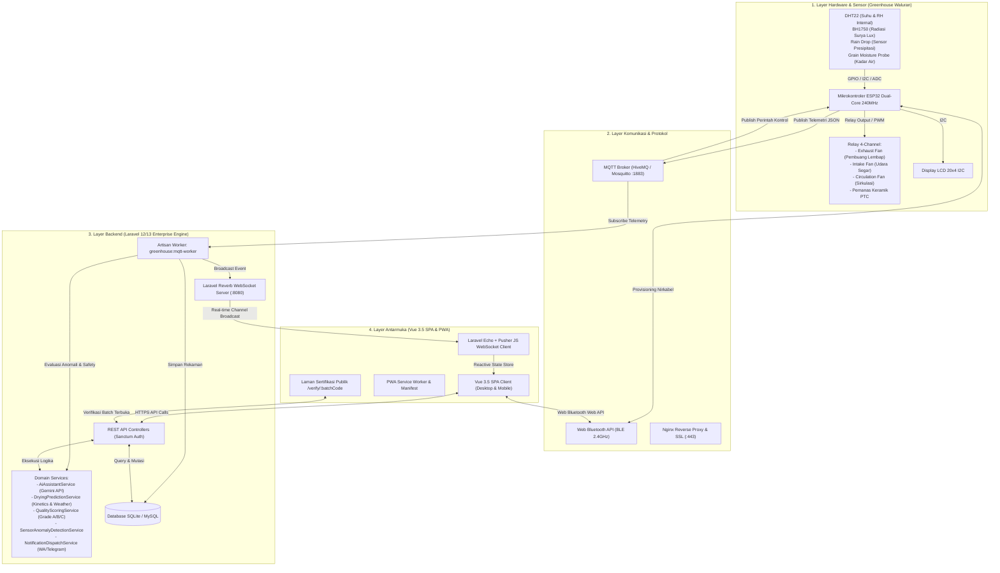
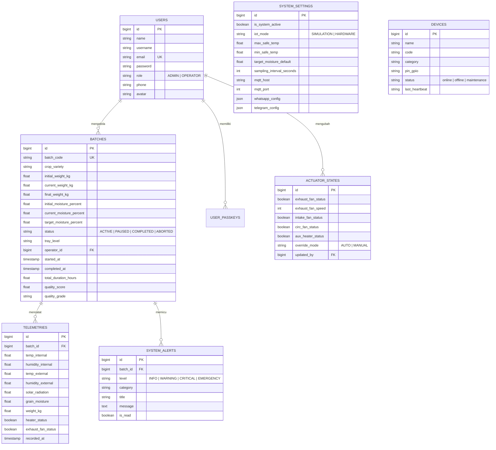

# ⚙️ Dokumentasi Arsitektur & Teknis Sistem
## Smart Room Dryer Hanjeli — IoT Greenhouse Monitoring & Control System

> **Versi Sistem**: v1.0.0 (Stable Release)  
> **Klasifikasi Dokumen**: Dokumentasi Arsitektur Perangkat Lunak, Integrasi IoT, dan Spesifikasi Teknis  
> **Sasaran Pembaca**: Software Engineer, DevOps, IoT/Embedded Engineer, dan System Administrator  
> **Institusi**: Center of Excellence Smart Telecommunication, Automation & System - Research Group (**CoE STAS-RG**)  
> **Mitra Lapangan**: Desa Wisata Hanjeli, Waluran Mandiri, Kab. Sukabumi, Jawa Barat

---

## 📋 Daftar Isi

1. [Ringkasan Eksekutif & Latar Belakang Sistem](#1-ringkasan-eksekutif--latar-belakang-sistem)
2. [Arsitektur Sistem Menyeluruh (End-to-End Architecture)](#2-arsitektur-sistem-menyeluruh-end-to-end-architecture)
3. [Spesifikasi Perangkat Keras ESP32 & Pinout GPIO](#3-spesifikasi-perangkat-keras-esp32--pinout-gpio)
4. [Protokol Komunikasi Data & Telemetri](#4-protokol-komunikasi-data--telemetri)
   - 4.1. [MQTT Telemetry Pipeline](#41-mqtt-telemetry-pipeline)
   - 4.2. [Laravel Reverb WebSockets](#42-laravel-reverb-websockets)
   - 4.3. [Web Bluetooth (BLE) GATT Architecture](#43-web-bluetooth-ble-gatt-architecture)
   - 4.4. [Web Serial API (USB Direct Transmission)](#44-web-serial-api-usb-direct-transmission)
5. [Arsitektur Backend (Laravel 12/13 Real-Time Server)](#5-arsitektur-backend-laravel-1213-real-time-server)
   - 5.1. [Struktur Direktori Backend](#51-struktur-direktori-backend)
   - 5.2. [Skema Basis Data (Database Schema & ERD)](#52-skema-basis-data-database-schema--erd)
   - 5.3. [Daftar Service Core & Algoritma Khusus](#53-daftar-service-core--algoritma-khusus)
6. [Arsitektur Frontend (Vue.js 3.5 SPA & PWA)](#6-arsitektur-frontend-vuejs-35-spa--pwa)
   - 6.1. [Struktur Direktori Frontend](#61-struktur-direktori-frontend)
   - 6.2. [Standar Desain Zero-Shadow](#62-standar-desain-zero-shadow)
   - 6.3. [Navigasi & Route Guard Berbasis RBAC](#63-navigasi--route-guard-berbasis-rbac)
   - 6.4. [Modul Lokalisasi Multi-Bahasa (i18n)](#64-modul-lokalisasi-multi-bahasa-i18n)
7. [Katalog Endpoint RESTful API](#7-katalog-endpoint-restful-api)
8. [Panduan Deployment Server & Multi-Service Orchestration](#8-panduan-deployment-server--multi-service-orchestration)
   - 8.1. [Konfigurasi Supervisor untuk Daemon Worker](#81-konfigurasi-supervisor-untuk-daemon-worker)
   - 8.2. [Konfigurasi Nginx Reverse Proxy & WebSocket WSS](#82-konfigurasi-nginx-reverse-proxy--websocket-wss)
9. [Pemeliharaan Sistem & Keamanan Data (Security & Maintenance)](#9-pemeliharaan-sistem--keamanan-data-security--maintenance)

---

## 1. Ringkasan Eksekutif & Latar Belakang Sistem

Sistem **Smart Room Dryer Hanjeli** dirancang untuk mengatasi hambatan pascapanen pada komoditas biji hanjeli (*Coix lacryma-jobi*) di Desa Wisata Hanjeli, Waluran Mandiri, Kabupaten Sukabumi. Biji hanjeli memiliki cangkang keras dengan densitas massa yang tinggi, sehingga proses pengeringan konvensional di bawah sinar matahari terbuka (*sun drying*) kerap terhambat oleh cuaca mendung, kontaminasi mikroba/jamur, dan fluktuasi kelembaban malam hari yang memicu pertumbuhan aflatoksin.

### Tujuan Rekayasa Sistem:
1. **Penyediaan Greenhouse Pintar**: Pengeringan dalam ruang tertutup beratap polikarbonat dengan bantuan sirkulasi udara terkontrol dan pemanas tambahan (*PTC Ceramic Heater*).
2. **Telemetri Berlatensi Rendah**: Pengumpulan data mikroiklim (suhu ruang, suhu luar, kelembaban udara internal/eksternal, radiasi matahari, dan kadar air biji) setiap 5 detik dengan visualisasi sub-detik di sisi browser.
3. **Otomatisasi & Safety Interlock**: Logika otomatis aktuator kipas dan pemanas untuk menjaga suhu optimal ($45^\circ\text{C} - 55^\circ\text{C}$) serta memutus daya pemanas saat batas bahaya tercapai.
4. **Kecerdasan Buatan Terintegrasi**: Prediksi waktu selesai pengeringan (*Predictive ETA*), pendeteksian anomali sensor secara instan (*Anomaly Detection*), asisten agronomis (*AI Copilot LLM*), serta penilaian mutu otomatis (*Quality Scoring Grade A/B/C*).
5. **Traceability & Public Certification**: QR Code unik di setiap batch kemasan yang dapat diverifikasi oleh konsumen secara publik untuk menjamin integritas mutu produk.

---

## 2. Arsitektur Sistem Menyeluruh (End-to-End Architecture)

Sistem mengadopsi arsitektur terdistribusi multi-layer yang menghubungkan perangkat keras mikrokontroler di perkebunan dengan server cloud dan browser pengguna:



---

## 3. Spesifikasi Perangkat Keras ESP32 & Pinout GPIO

Firmware mikrokontroler menggunakan board **ESP32-WROOM-32** (Dual-Core Tensilica Xtensa 32-bit LX6, 240 MHz, 520 KB SRAM, 4 MB Flash).

### Tabel Pemetaan Pinout ESP32 (Hardware Map):

| Komponen / Sensor | Tipe Sinyal | Pin GPIO ESP32 | Mode Pin | Deskripsi Fungsional |
| :--- | :--- | :--- | :--- | :--- |
| **DHT22 (Internal)** | Digital One-Wire | `GPIO 25` | `INPUT_PULLUP` | Mengukur Suhu Ruang ($0^\circ\text{C} - 80^\circ\text{C}$) dan Kelembaban Relatif ($0\% - 100\%\text{ RH}$). |
| **BH1750 (Sensor Surya)** | I2C Data (SDA) | `GPIO 21` | `I2C` | Mengukur radiasi cahaya matahari ($0 - 65.535\text{ Lux}$). Address I2C: `0x23`. |
| **BH1750 (Clock)** | I2C Clock (SCL) | `GPIO 22` | `I2C` | Sinyal clock bus I2C BH1750 dan LCD 20x4. |
| **Rain Drop Sensor** | Analog ADC | `GPIO 34` | `ANALOG (ADC1_CH6)`| Deteksi presipitasi air hujan pada atap. Nilai ADC: $0$ (Basah Ekstrem) s.d. $4095$ (Kering). Threshold hujan: $< 2000$. |
| **LCD 20x4 I2C** | I2C Bus | `GPIO 21, 22` | `I2C` | Penampil diagnostik lokal 4 baris 20 karakter. Address I2C: `0x27`. |
| **Relay 1 — Pemanas PTC 1** | Digital Output | `GPIO 26` | `OUTPUT` | Saklar Pemanas Keramik PTC Saluran 1 (Active-Low / Active-High relay). |
| **Relay 2 — Pemanas PTC 2** | Digital Output | `GPIO 27` | `OUTPUT` | Saklar Pemanas Keramik PTC Saluran 2. |
| **Relay 3 — Exhaust Fan** | Digital / PWM | `GPIO 14` | `OUTPUT` | Saklar Kipas Pembuang Uap Udara Lembap ke luar greenhouse. |
| **Relay 4 — Circulation Fan**| Digital Output | `GPIO 12` | `OUTPUT` | Saklar Kipas Perata Suhu & Sirkulasi Internal Ruang. |

### Logika Safety Cutoff Pemanas PTC:
Untuk menjamin keamanan termal dan mencegah risiko kebakaran atau kerusakan biji hanjeli:
1. **Auto ON**: Pemanas aktif jika Suhu Ruang $< 40.0^\circ\text{C}$ dan Kelembaban Ruang $> 60\%$ (saat batch berstatus `ACTIVE`).
2. **Auto OFF**: Pemanas wajib dimatikan seketika saat Suhu Ruang $\ge 55.0^\circ\text{C}$.
3. **Emergency Interlock**: Jika terjadi kegagalan pembacaan sensor DHT22 sebanyak 3 siklus berturut-turut (nilai bernilai `NaN`), mikrokontroler secara otomatis memutus relay pemanas seketika.

---

## 4. Protokol Komunikasi Data & Telemetri

Sistem menerapkan prinsip *Redundant Communication Pipeline* untuk menjamin data tetap terkirim walaupun terjadi gangguan jaringan sementara.

### 4.1. MQTT Telemetry Pipeline
- **Broker Standar**: `broker.hivemq.com` / Mosquitto Server (Port `1883`)
- **Topik Ingest Telemetri**: `hanjeli/greenhouse/telemetry`
- **Topik Kontrol Aktuator**: `hanjeli/greenhouse/actuators`
- **Topik Perintah Umum**: `hanjeli/greenhouse/command`

#### Payload Format — Telemetri Masuk (ESP32 $\rightarrow$ Server):
```json
{
  "deviceId": "ESP32-HANJELI-01",
  "tempInternal": 48.5,
  "humidityInternal": 42.0,
  "tempExternal": 31.2,
  "humidityExternal": 75.0,
  "solarRadiation": 680,
  "grainMoisture": 16.8,
  "weightKg": 92.4,
  "exhaustFan": true,
  "intakeFan": false,
  "circFan": true,
  "auxHeater": false,
  "batteryLevel": 98,
  "timestamp": 1725883200
}
```

#### Payload Format — Kontrol Aktuator (Server $\rightarrow$ ESP32):
```json
{
  "target": "EXHAUST_FAN",
  "state": true,
  "speed": 80,
  "mode": "MANUAL",
  "timestamp": 1725883200
}
```

---

### 4.2. Laravel Reverb WebSockets
Laravel Reverb bertindak sebagai server WebSocket native berperforma tinggi (kapasitas ribuan koneksi paralel dengan memori minimal):
- **Port Layanan**: `8080` (HTTP lokal) atau `443` (WSS melalui Nginx Reverse Proxy).
- **Public Channel**:
  - `greenhouse.telemetry`: Menyiarkan event `TelemetryUpdated` setiap kali ada data masuk dari MQTT worker.
  - `actuator.updated`: Menyiarkan perubahan status relay/kipas/pemanas secara *real-time*.
  - `alert.triggered`: Menyiarkan peringatan anomali suhu/kelembaban kritis ke seluruh operator yang sedang membuka web.

---

### 4.3. Web Bluetooth (BLE) GATT Architecture
Digunakan untuk konfigurasi lapangan (*local device provisioning*) tanpa jaringan internet:
- **Nama Advertised BLE**: `SMART-DRYER-PROVISION`
- **GATT Primary Service UUID**: `4fafc201-1fb5-459e-8fcc-c5c9c331914b`
- **WiFi Config Characteristic UUID**: `beb5483e-36e1-4688-b7f5-ea07361b26a8` (Sifat: Read/Write).
- **Sensor Calibration Characteristic UUID**: `1c95d5e3-d8f7-413a-bf3d-7a2e5d7be87e` (Sifat: Read/Write).

---

### 4.4. Web Serial API (USB Direct Transmission)
Digunakan sebagai jalur darurat (*zero-network fallback*) dan stasiun diagnostik langsung di workstation greenhouse ketika jaringan Wi-Fi dan Bluetooth tidak tersedia:
- **API Browser**: W3C Web Serial API (didukung penuh pada peramban berbasis Chromium seperti Google Chrome dan Microsoft Edge).
- **Kecepatan Baud (Baud Rate)**: `115200` bps, 8 data bits, no parity, 1 stop bit (`8-N-1`).
- **Mekanisme Framing**: Text line stream dengan delimiter karakter baris baru (`\n`).
- **Format Paket Data Masuk**: String JSON yang identik dengan kontrak telemetri MQTT (dibaca secara reaktif melalui `ReadableStreamDefaultReader`).
- **Kontrol Balik**: Perintah kontrol aktuator atau kalibrasi dikirim balik ke ESP32 melalui `WritableStreamDefaultWriter` secara langsung tanpa transit ke internet.

---

## 5. Arsitektur Backend (Laravel 12/13 Real-Time Server)

Backend dibangun di atas Laravel versi 12/13 dengan PHP 8.3+, menerapkan pola arsitektur *Service-Repository Pattern* yang bersih dan modular.

### 5.1. Struktur Direktori Backend
```
app/
├── Console/Commands/
│   └── GreenhouseMqttWorker.php        # Daemon penangkap paket MQTT berkelanjutan
├── Events/
│   ├── ActuatorUpdated.php             # Event broadcast status aktuator
│   ├── AlertTriggered.php              # Event broadcast peringatan sistem
│   └── TelemetryUpdated.php            # Event broadcast pembacaan sensor
├── Http/Controllers/Api/
│   ├── ActuatorController.php          # Kontrol aktuator & toggle mode
│   ├── AiAssistantController.php       # Controller tanya jawab AI Copilot
│   ├── AlertController.php             # Manajemen notifikasi & alert
│   ├── AnomalyController.php           # Diagnostik & simulasi anomali
│   ├── AuthController.php              # Login, register, passkeys, Google OAuth, OTP
│   ├── BatchController.php             # Siklus batch, prediksi, mutu, export PDF/Excel
│   ├── DashboardController.php         # Ringkasan analitik dasbor
│   ├── DeviceController.php            # Manajemen perangkat IoT, ping test, OTA firmware
│   ├── DryingPredictionController.php  # Prediksi ETA & kinetika pengeringan
│   ├── SettingController.php           # Pengaturan sistem, ambang batas, tes WA/Telegram
│   ├── TelemetryController.php         # Ingest data, query riwayat, downsampling
│   └── UserController.php              # Manajemen akun & RBAC pengguna
├── Models/
│   ├── ActuatorState.php               # Status relay terkini
│   ├── Batch.php                       # Entitas siklus batch pengeringan
│   ├── Device.php                      # Entitas perangkat keras/sensor
│   ├── FirmwareRelease.php             # Arsip rilis biner firmware OTA
│   ├── SystemAlert.php                 # Entitas notifikasi peringatan
│   ├── SystemSetting.php               # Konfigurasi parameter master sistem
│   ├── Telemetry.php                   # Catatan time-series data sensor
│   ├── User.php                        # Entitas pengguna sistem
│   └── UserPasskey.php                 # Kredensial kriptografi WebAuthn
└── Services/
    ├── AiAssistantService.php          # Integrasi Gemini API & Fallback Agro-Engine
    ├── AlertNotificationService.php    # Pemicu ambang batas notifikasi
    ├── DryingPredictionService.php     # Kinetika pengeringan & cuaca Waluran
    ├── MqttService.php                 # Abstraksi koneksi MQTT client
    ├── NotificationDispatchService.php # Dispatcher Telegram, WhatsApp & Email
    ├── QualityScoringService.php       # Perhitungan skor mutu & grading A/B/C
    ├── SensorAnomalyDetectionService.php# Deteksi anomali fisik & thermal paradox
    ├── TelegramNotificationService.php # Integrasi bot Telegram
    ├── TelemetryAggregationService.php # Downsampling agregasi database
    └── WhatsAppNotificationService.php # Integrasi gateway WhatsApp
```

---

### 5.2. Skema Basis Data (Database Schema & ERD)

Berikut adalah entitas tabel utama dalam basis data sistem:



---

### 5.3. Daftar Service Core & Algoritma Khusus

1. **`AiAssistantService`**:
   - Menghubungkan sistem ke model bahasa besar (LLM) **Google Gemini (`gemini-3.6-flash`)** menggunakan token API.
   - Menginjeksikan *snapshot* konteks mikroiklim real-time (suhu terkini, status kipas, progres batch aktif) ke dalam *system prompt*.
   - **Agro-Heuristic Fallback**: Jika kuota Gemini habis atau koneksi internet terputus, sistem secara otomatis beralih ke mesin heuristik lokal berbasis aturan agronomi pakar hanjeli tanpa membuat aplikasi error.

2. **`DryingPredictionService`**:
   - Memodelkan laju difusi air dari endosperma biji hanjeli menggunakan persamaan kinetika pengeringan lapisan tipis (*thin-layer drying model*).
   - Memadukan data geolokasi Waluran, Sukabumi (`Lat: -7.1825, Long: 106.5514`) dengan prakiraan cuaca satelit per jam (*solar irradiance projection*) untuk memperkirakan sisa jam pengeringan secara presisi.

3. **`QualityScoringService`**:
   - Menghitung nilai komposit mutu akhir ($0 - 100$) berdasarkan 3 pilar:
     1. Nilai Kadar Air Akhir (Bobot: 45%).
     2. Stabilitas Termal & Suhu Maksimum Ruang (Bobot: 35%).
     3. Kestabilan Kelembaban Relatif (Bobot: 20%).
   - Menentukan Grade Mutu otomatis (`Grade A`, `Grade B`, atau `Grade C`) dan menerbitkan rekomendasi pasar (vakum premium, konsumsi lokal, atau olahan tepung).

4. **`SensorAnomalyDetectionService`**:
   - Menginspeksi setiap paket telemetri baru untuk 4 jenis anomali:
     1. *Out-of-Bounds*: Nilai melampaui batas fisik wajar (misal: suhu $> 85^\circ\text{C}$ atau kadar air $< 0\%$).
     2. *Thermal Paradox*: Pemanas aktif bekerja, namun suhu ruang anjlok $> 3^\circ\text{C}$ dalam 2 menit berturut-turut (indikasi pintu terbuka atau elemen rusak).
     3. *Flatlining / Freeze*: Nilai sensor identik statis lebih dari 100 pembacaan berturut-turut (indikasi mikrokontroler hang).
     4. *Rapid Spike*: Kenaikan drastis tak wajar dalam hitungan detik.

---

## 6. Arsitektur Frontend (Vue.js 3.5 SPA & PWA)

Frontend dibangun sebagai *Single Page Application* (SPA) menggunakan **Vue 3.5** dengan paradigma modern Composition API (`<script setup>`) yang dikompilasi oleh **Vite**.

### 6.1. Struktur Direktori Frontend
```
resources/js/
├── components/                 # Komponen antarmuka modular
│   ├── ActuatorControlCard.vue # Kartu kendali saklar relay kipas & pemanas
│   ├── AiCopilotDrawer.vue     # Drawer asisten AI Gemini
│   ├── ConnectionStatusCard.vue# Health monitor multi-saluran (Wi-Fi, BLE, USB Serial, Sim)
│   ├── DesktopHeader.vue       # Header navigasi desktop
│   ├── DesktopSidebar.vue      # Sidebar navigasi desktop
│   ├── DeviceSetupBleModal.vue # Modal pairing Web Bluetooth
│   ├── HardwareSimulatorModal.vue# Modal simulator sensor & pengujian lingkungan
│   ├── MobileBottomNav.vue     # Navigasi bawah smartphone (PWA)
│   ├── MobileHeader.vue        # Header ringkas smartphone
│   ├── PackagingQrLabelModal.vue# Generator stiker label QR batch
│   └── ui/                     # Primitif UI (Button, Modal, Card, Badge, Skeleton)
├── i18n/                       # Modul multibahasa reaktif
│   └── locales/                # id.js & en.js (Bahasa Indonesia & English)
├── router/
│   └── index.js                # Definisi rute, Page Titles, & Navigation Guards RBAC
├── services/                   # Service layer API client
│   ├── anomalyService.js       # Client deteksi anomali sensor
│   ├── api.js                  # Axios client terkonfigurasi Sanctum & CSRF
│   ├── authService.js          # Manajemen state login, token & biometrik
│   ├── batchService.js         # Client siklus batch pengeringan & ekspor
│   ├── bleService.js           # Implementasi Web Bluetooth API
│   ├── connectionManager.js    # Manajemen multi-mode koneksi (Wi-Fi, BLE, USB)
│   ├── mqttService.js          # Client listener MQTT web
│   ├── settingsService.js      # Client parameter konfigurasi sistem
│   ├── simulatorService.js     # Engine simulasi telemetri
│   ├── themeService.js         # Pengendali tema Light/Dark
│   ├── usbSerialService.js     # Implementasi W3C Web Serial API (USB Direct)
│   └── websocketService.js     # Client Laravel Echo & Pusher JS (Reverb)
├── views/                      # Halaman tampilan modul
│   ├── admin/                  # Halaman Admin (Overview, Users, Devices, Logs, Parameters)
│   ├── auth/                   # Halaman Auth (Login, ForgotPassword)
│   ├── errors/                 # Halaman Error (NotFound 404, ServerError 500, Forbidden 403)
│   ├── operator/               # Halaman Operator (Dashboard, Monitoring, DryingForm, ActiveDrying, History, HistoryDetail, Settings, Guide)
│   └── public/                 # Halaman Terbuka (LandingView, PublicTraceabilityVerifyView)
├── App.vue                     # Root Component
└── app.js                      # Entry point JavaScript
```

---

### 6.2. Standar Desain Zero-Shadow
Sesuai panduan [`docs/DESIGN.md`](./DESIGN.md), antarmuka sepenuhnya menghilangkan elevasi bayangan (`box-shadow: none`). Pemisahan visual dicapai secara elegan melalui:
- **Border Stroke**: Garis tepi tegas `1px` atau `1.5px` menggunakan warna semantik (`--color-border: #CBD5E1` pada light mode, `#1E3A2B` pada dark mode).
- **Palet Warna Pertanian**: Hijau Hanjeli Primer (`#0D631B` dan `#2E7D32`), Oranye Termal Pemanas (`#EA580C`), Biru Kelembaban (`#0284C7`), dan Amber Kadar Air (`#D97706`).
- **Surface Elevation**: Pembedaan latar kartu (`#FFFFFF` / `#13271C`) terhadap latar halaman (`#F4F7F5` / `#0B1911`).

---

### 6.3. Modul Khusus Terintegrasi

#### A. Manajemen Armada Perangkat & Firmware OTA (`/admin/devices`)
Modul terintegrasi yang menyatukan pemantauan fisik, diagnostik, dan simulasi dalam 7 sub-navigasi:
1. **Otentikasi Token & Keamanan API (`security`)**: Manajemen otentikasi HMAC dan `X-Device-Token` anti-spoofing.
2. **Manajemen Firmware OTA (`ota`)**: Eksekusi pembaruan Over-The-Air, pengunggahan biner `.bin`, dan pemantauan progress bar flashing armada.
3. **Pustaka Rilis Firmware (`releases`)**: Repositori arsip versi rilis biner mikrokontroler dengan validasi checksum.
4. **Matriks Kesehatan Sensor & Latensi (`sensors`)**: Pelacakan heartbeat berkala dan pemantauan latensi pulang-pergi (*Round-Trip Time*).
5. **Kontrol Sakelar Relai & Aktuator Hardware (`actuators`)**: Pengujian langsung sakelar relay 4 kanal (Pemanas PTC 1 & 2, Kipas Exhaust, Kipas Sirkulasi) dari panel admin.
6. **Katalog Sensor & Hardware Greenhouse (6) (`catalog`)**: Spesifikasi teknis 6 komponen IoT utama fasilitas.
7. **Program Arduino / Source Code ESP32 (2) (`arduino`)**: Penampil dan pengunduh kode firmware mikrokontroler produksi dan simulator.

#### B. Pengaturan Komprehensif Sistem (`/settings`)
Menyediakan 4 tab kendali utama:
1. **Saluran Transmisi Utama & Kalibrasi (`hardware`)**: Pemilihan mode koneksi live (Wi-Fi, Bluetooth BLE, atau Kabel USB Langsung via Web Serial API), kalibrasi offset sensor, dan konfigurasi jaringan ESP32.
2. **Parameter Pengeringan (`drying`)**: Konfigurasi batas aman suhu, kelembaban, dan preset profil pengeringan hanjeli (Basah Panen ~26%, Setengah Kering ~18%, Pemeliharaan ~12%).
3. **Saluran Notifikasi & Digest (`notifications`)**: Konfigurasi peringatan multi-saluran (Email SMTP, WhatsApp Gateway, Telegram Bot) serta pengiriman instan *Daily Digest*.
4. **Keamanan Akun & Biometrik (`security`)**: Manajemen kata sandi, pendaftaran Passkeys (WebAuthn / Fingerprint / FaceID), dan pemantauan sesi aktif.

#### C. Portal Sertifikasi & Verifikasi Mutu Publik (`/verify` & `/verify/:batchCode`)
Portal terbuka tanpa login bagi konsumen dan mitra:
- Pencarian kode batch dan integrasi pemindaian QR Code kamera ponsel.
- Sertifikat mutu resmi berstempel digital CoE STAS-RG & Desa Wisata Hanjeli.
- Penilaian Grade Mutu (Grade A/B/C) beserta rincian gizi pangan fungsional (protein, serat pangan, karbohidrat kompleks, zat besi).
- Kurva analitik interaktif mikroiklim selama pengeringan berlangsung (suhu, kelembaban, dan radiasi matahari).
- Tombol cetak dan unduh dokumen sertifikat mutu resmi.

---

### 6.4. Navigasi & Route Guard Berbasis RBAC
File `resources/js/router/index.js` mengimplementasikan *Navigation Guards* (`router.beforeEach`):
1. **Pemeriksaan Otorisasi (`requiresAuth`)**: Jika pengguna belum memiliki token Sanctum yang valid, otomatis dialihkan ke `/login`.
2. **Pemisahan Peran (`role`)**:
   - Halaman `/admin/*` hanya dapat diakses oleh akun dengan `role === 'ADMIN'`. Jika operator mencoba membuka URL ini, router melempar ke halaman `/403 (Forbidden)`.
   - Halaman `/dashboard` dan `/drying/*` dioptimalkan untuk operator. Administrator yang membuka dashboard otomatis diarahkan ke `/admin`.
3. **Guest Only (`guestOnly`)**: Pengguna yang telah login tidak dapat membuka halaman `/login` atau `/forgot-password`.

---

### 6.5. Modul Lokalisasi Multi-Bahasa (i18n)
Sistem menggunakan modul reaktif internal yang tersimpan pada `localStorage`:
- File terjemahan: `resources/js/i18n/locales/id.js` (Bahasa Indonesia) dan `resources/js/i18n/locales/en.js` (English).
- Pergantian bahasa terjadi secara reaktif instan di seluruh komponen tanpa memuat ulang halaman (*zero page refresh*).

---

## 7. Katalog Endpoint RESTful API

Seluruh endpoint diawali dengan prefix `/api/` (atau `/api/v1/`). Format respon standar:
```json
{
  "success": true,
  "message": "Deskripsi respon operasi",
  "data": { ... }
}
```

### Tabel Ringkasan Endpoint Utama:

| Method | Endpoint | Hak Akses | Keterangan & Fungsi |
| :--- | :--- | :--- | :--- |
| `POST` | `/api/auth/login` | Public | Autentikasi email & password, mengembalikan bearer token Sanctum |
| `POST` | `/api/auth/register` | Public | Registrasi akun operator baru |
| `POST` | `/api/auth/google` | Public | Autentikasi token Google OAuth 2.0 |
| `POST` | `/api/auth/forgot-password`| Public | Permintaan kirim kode OTP 6 digit ke email |
| `POST` | `/api/auth/verify-otp` | Public | Validasi kode OTP email |
| `POST` | `/api/auth/reset-password`| Public | Reset kata sandi baru pasca verifikasi OTP |
| `POST` | `/api/auth/passkey/options`| Public | Permintaan challenge options WebAuthn |
| `POST` | `/api/auth/passkey/verify` | Public | Verifikasi tanda tangan biometrik passkey |
| `POST` | `/api/auth/passkey/register`| Authenticated | Pendaftaran credential Passkey biometrik baru |
| `GET` | `/api/auth/profile` | Authenticated | Mengambil data profil pengguna yang sedang login |
| `PUT` | `/api/auth/profile` | Authenticated | Memperbarui profil pengguna & nomor kontak |
| `POST` | `/api/auth/logout` | Authenticated | Mencabut token sesi aktif (logout) |
| `GET` | `/api/dashboard/stats` | Operator / Admin | Ringkasan statistik metrik & status batch aktif |
| `GET` | `/api/batches` | Operator / Admin | Daftar seluruh batch pengeringan |
| `GET` | `/api/batches/active` | Operator / Admin | Mendapatkan data batch yang sedang berjalan aktif |
| `POST` | `/api/batches` | Operator | Memulai batch pengeringan baru |
| `GET` | `/api/batches/{id}` | Operator / Admin | Detail lengkap informasi satu batch |
| `PUT` | `/api/batches/{id}` | Operator / Admin | Memperbarui informasi batch pengeringan |
| `PATCH`| `/api/batches/{id}/pause` | Operator | Menjeda sementara proses pengeringan |
| `PATCH`| `/api/batches/{id}/resume`| Operator | Melanjutkan kembali pengeringan yang terjeda |
| `PATCH`| `/api/batches/{id}/complete`| Operator | Menyelesaikan batch & menghitung skor mutu |
| `GET` | `/api/batches/{id}/export` | Operator / Admin | Ekspor laporan batch format PDF, Excel, atau CSV |
| `GET` | `/api/batches/{id}/verification`| Public / Auth | Mendapatkan data verifikasi traceability batch |
| `GET` | `/api/batches/{id}/quality-assessment`| Operator / Admin | Data asesmen detail skor kualitas Grade A/B/C |
| `GET` | `/api/batches/{id}/drying-prediction`| Operator / Admin | Prediksi sisa waktu pengeringan batch spesifik |
| `GET` | `/api/drying/predictive-eta`| Operator / Admin | Estimasi ETA real-time untuk batch yang sedang aktif |
| `GET` | `/api/drying/weather-forecast`| Operator / Admin | Prakiraan cuaca & radiasi satelit Waluran |
| `GET` | `/api/public/verify/{batch_code}`| Public | Portal verifikasi mutu & traceability publik konsumen |
| `GET` | `/api/telemetry/current` | Operator / Admin | Pembacaan sensor terkini |
| `GET` | `/api/telemetry/history` | Operator / Admin | Riwayat telemetri berfilter rentang waktu |
| `POST` | `/api/telemetry/ingest` | Public / Device | Endpoint HTTP fallback untuk pengiriman data ESP32 |
| `POST` | `/api/telemetry/downsample`| Admin | Menjalankan agregasi pemadatan data historis |
| `GET` | `/api/telemetry/storage-stats`| Admin | Statistik utilisasi penyimpanan database telemetri |
| `GET` | `/api/actuators/status` | Operator / Admin | Mendapatkan status relay aktuator saat ini |
| `PATCH`| `/api/actuators/control` | Operator | Mengubah status/kecepatan kipas & pemanas |
| `GET` | `/api/devices` | Admin | Daftar seluruh perangkat keras & sensor IoT |
| `POST` | `/api/devices` | Admin | Menambahkan perangkat IoT / sensor baru |
| `POST` | `/api/devices/ping-all` | Admin | Mengirim paket detak jantung ping ke seluruh node |
| `POST` | `/api/devices/{id}/ping` | Admin | Mengirim paket detak jantung ping ke perangkat spesifik |
| `POST` | `/api/devices/{id}/toggle` | Admin | Mengaktifkan / menonaktifkan status perangkat |
| `POST` | `/api/devices/{id}/regenerate-token`| Admin | Mereset token autentikasi rahasia perangkat |
| `POST` | `/api/devices/{id}/trigger-ota` | Admin | Memicu sinyal update firmware OTA ke perangkat |
| `PUT` | `/api/devices/{id}` | Admin | Mengubah informasi perangkat atau pin GPIO |
| `DELETE`| `/api/devices/{id}` | Admin | Menghapus perangkat dari database armada |
| `GET` | `/api/firmware/ota/check` | Device | Polling ESP32 untuk mengecek versi update firmware |
| `POST` | `/api/firmware/ota/progress` | Device | Laporan persentase progres flashing OTA dari ESP32 |
| `GET` | `/api/firmware/releases` | Admin | Daftar riwayat arsip rilis firmware (.bin) |
| `POST` | `/api/firmware/releases` | Admin | Mengunggah file biner firmware OTA baru |
| `GET` | `/api/settings` | Admin | Membaca parameter master konfigurasi sistem |
| `PUT` | `/api/settings` | Admin | Memperbarui parameter batas aman suhu & MQTT |
| `POST` | `/api/settings/test-email` | Admin | Uji coba pengiriman alert ke Email SMTP |
| `POST` | `/api/settings/test-telegram` | Admin | Uji coba pengiriman alert ke Telegram |
| `POST` | `/api/settings/test-whatsapp` | Admin | Uji coba pengiriman alert ke WhatsApp |
| `POST` | `/api/settings/daily-digest/send-now`| Admin | Memicu pengiriman ringkasan harian instan |
| `GET` | `/api/alerts` | Operator / Admin | Daftar seluruh notifikasi peringatan sistem |
| `PATCH`| `/api/alerts/{id}/read` | Operator / Admin | Menandai satu notifikasi telah dibaca |
| `PATCH`| `/api/alerts/read-all` | Operator / Admin | Menandai seluruh notifikasi telah dibaca |
| `DELETE`| `/api/alerts/{id}` | Operator / Admin | Menghapus satu notifikasi peringatan |
| `DELETE`| `/api/alerts/clear` | Operator / Admin | Menghapus seluruh riwayat notifikasi |
| `GET` | `/api/anomalies/status` | Operator / Admin | Mendapatkan status kesehatan diagnostik sensor |
| `POST` | `/api/anomalies/check` | Operator / Admin | Menjalankan evaluasi inspeksi anomali instan |
| `POST` | `/api/ai/chat` | Operator / Admin | Berinteraksi dengan AI Copilot Gemini |
| `GET` | `/api/ai/suggestions` | Operator / Admin | Mendapatkan rekomendasi pertanyaan cepat AI |
| `GET` | `/api/ai/context` | Operator / Admin | Snapshot mikroiklim terkini untuk konteks AI |
| `GET` | `/api/auth/users` | Admin | Daftar seluruh pengguna sistem |
| `POST` | `/api/auth/users` | Admin | Membuat akun pengguna baru |
| `PUT` | `/api/auth/users/{id}` | Admin | Memperbarui data pengguna |
| `PUT` | `/api/auth/users/{id}/role` | Admin | Mengubah peran pengguna (`ADMIN` / `OPERATOR`) |
| `DELETE`| `/api/auth/users/{id}` | Admin | Menghapus akun pengguna |

---

## 8. Panduan Deployment Server & Multi-Service Orchestration

Untuk menjamin keandalan sistem di tingkat produksi (*production-grade*), arsitektur membutuhkan 3 proses daemon yang berjalan terus menerus.

### 8.1. Konfigurasi Supervisor untuk Daemon Worker
Pasang Supervisor pada server Ubuntu/Debian:
```bash
sudo apt-get install supervisor
```

Buat file konfigurasi `/etc/supervisor/conf.d/smart-dryer.conf`:
```ini
[program:smart-dryer-reverb]
process_name=%(program_name)s_%(process_num)02d
command=php /var/www/app-smart-dryer-hanjeli/artisan reverb:start --host=0.0.0.0 --port=8080
autostart=true
autorestart=true
user=www-data
numprocs=1
redirect_stderr=true
stdout_logfile=/var/www/app-smart-dryer-hanjeli/storage/logs/reverb.log

[program:smart-dryer-mqtt]
process_name=%(program_name)s_%(process_num)02d
command=php /var/www/app-smart-dryer-hanjeli/artisan greenhouse:mqtt-worker
autostart=true
autorestart=true
user=www-data
numprocs=1
redirect_stderr=true
stdout_logfile=/var/www/app-smart-dryer-hanjeli/storage/logs/mqtt-worker.log
```

Aktifkan konfigurasi:
```bash
sudo supervisorctl reread
sudo supervisorctl update
sudo supervisorctl start all
```

---

### 8.2. Konfigurasi Nginx Reverse Proxy & WebSocket WSS
Contoh konfigurasi Nginx `/etc/nginx/sites-available/smart-dryer`:
```nginx
server {
    listen 80;
    server_name dryer.hanjeli.id;
    return 301 https://$host$request_uri;
}

server {
    listen 443 ssl http2;
    server_name dryer.hanjeli.id;

    ssl_certificate /etc/letsencrypt/live/dryer.hanjeli.id/fullchain.pem;
    ssl_certificate_key /etc/letsencrypt/live/dryer.hanjeli.id/privkey.pem;

    root /var/www/app-smart-dryer-hanjeli/public;
    index index.php index.html;

    # Header Keamanan
    add_header X-Frame-Options "SAMEORIGIN";
    add_header X-XSS-Protection "1; mode=block";
    add_header X-Content-Type-Options "nosniff";

    location / {
        try_files $uri $uri/ /index.php?$query_string;
    }

    # Proxy WebSocket Laravel Reverb
    location /app {
        proxy_pass http://127.0.0.1:8080;
        proxy_http_version 1.1;
        proxy_set_header Upgrade $http_upgrade;
        proxy_set_header Connection "Upgrade";
        proxy_set_header Host $host;
        proxy_cache_bypass $http_upgrade;
        proxy_read_timeout 60s;
    }

    location ~ \.php$ {
        include snippets/fastcgi-php.conf;
        fastcgi_pass unix:/var/run/php/php8.3-fpm.sock;
    }
}
```

---

## 9. Pemeliharaan Sistem & Keamanan Data (Security & Maintenance)

1. **Proteksi Akses Token Sanctum**: Seluruh otentikasi API menggunakan token hashing SHA-256 tersimpan di tabel `personal_access_tokens`.
2. **Brute-Force Rate Limiting**: Endpoint login dibatasi maksimal 5 percobaan gagal per menit per IP untuk mencegah serangan penebakan kata sandi.
3. **Database Downsampling Routine**:
   - Untuk menjaga performa kueri grafik, jalankan command terjadwal (cron job) mingguan:
     ```bash
     php artisan telemetry:downsample
     ```
   - Perintah ini merangkum rekaman per 5 detik menjadi nilai rata-rata per 15 menit untuk data yang berusia lebih dari 30 hari.
4. **Backup Basis Data Harian**:
   - Buat skrip cron job harian untuk mencadangkan database SQLite/MySQL ke penyimpanan aman di luar server.

---

*Dokumen ini diterbitkan secara resmi sebagai acuan rekayasa sistem Smart Room Dryer Hanjeli. Hak Cipta © 2026 CoE STAS-RG & Desa Wisata Hanjeli.*
