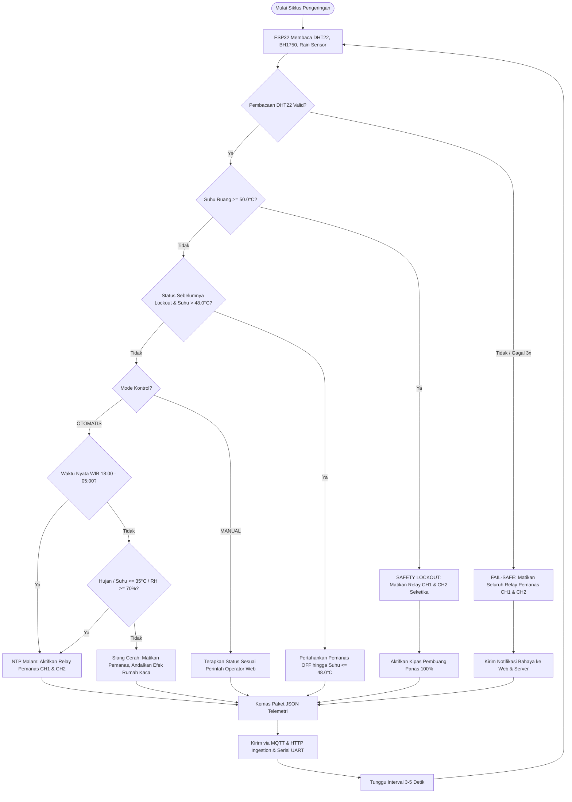

# 📜 Dokumen Pendaftaran Hak Kekayaan Intelektual (HKI)
## Deskripsi Ciptaan Program Komputer & Spesifikasi Inovasi Sistem Cerdas
### Smart Room Dryer Hanjeli — IoT Greenhouse Monitoring & Control System

> **Klasifikasi Dokumen**: Deskripsi Resmi Ciptaan Program Komputer (Surat Permohonan Hak Cipta DJKI Kemenkumham RI) & Draft Spesifikasi Inovasi Paten Sederhana  
> **Kategori Ciptaan**: Program Komputer (Software & Embedded Firmware)  
> **Tanggal Penyusunan**: 2026  
> **Lembaga Pengusul**: Center of Excellence Smart Telecommunication, Automation & System - Research Group (**CoE STAS-RG**)  
> **Mitra Lapangan**: Desa Wisata Hanjeli, Waluran Mandiri, Kab. Sukabumi, Jawa Barat  

---

## 📋 DAFTAR ISI

1. [Identitas Ciptaan & Data Pengusul](#1-identitas-ciptaan--data-pengusul)
2. [Latar Belakang & Urgensi Masalah Pascapanen Hanjeli](#2-latar-belakang--urgensi-masalah-pascapanen-hanjeli)
3. [Ringkasan Eksekutif & Karakteristik Inovasi (Novelty)](#3-ringkasan-eksekutif--karakteristik-inovasi-novelty)
4. [Arsitektur Sistem & Spesifikasi Teknis Program Komputer](#4-arsitektur-sistem--spesifikasi-teknis-program-komputer)
5. [Diagram Alir Sistem (Flowchart & Blok Diagram)](#5-diagram-alir-sistem-flowchart--blok-diagram)
6. [Deskripsi Modul Fungsional & Fitur Program Komputer](#6-deskripsi-modul-fungsional--fitur-program-komputer)
7. [Inovasi Logika Kontrol Dual-Channel & Safety Interlock](#7-inovasi-logika-kontrol-dual-channel--safety-interlock)
8. [Penggalan Kode Sumber Program Komputer (Source Code Samples)](#8-penggalan-kode-sumber-program-komputer-source-code-samples)
9. [Deskripsi Antarmuka Pengguna (User Interface Specification)](#9-deskripsi-antarmuka-pengguna-user-interface-specification)
10. [Klaim Inovasi & Potensi Paten Sederhana](#10-klaim-inovasi--potensi-paten-sederhana)
11. [Surat Pernyataan Keaslian & Pengalihan Hak Cipta](#11-surat-pernyataan-keaslian--pengalihan-hak-cipta)

---

## 1. IDENTITAS CIPTAAN & DATA PENGUSUL

### 1.1. Data Ciptaan Program Komputer
- **Judul Ciptaan**:  
  *Sistem Cerdas Otomasi dan Pemantauan Pengeringan Biji Hanjeli Berbasis Agro-Industrial IoT, WebSockets Real-Time, dan Web Bluetooth (BLE)*  
  *(Smart Room Dryer Hanjeli Web & Embedded System)*
- **Jenis Ciptaan**: Program Komputer (Perangkat Lunak Aplikasi Web & Firmware Mikrokontroler)
- **Sub-Jenis**: Sistem Pemantauan dan Pengendalian Otomasi Industri Pertanian Berbasis Internet of Things (IoT)
- **Bahasa Pemrograman Utama**: PHP (v8.3+ / Laravel 12 Framework), JavaScript (Vue.js 3.5, Node.js), C++ (Arduino ESP32 Core), SQL, HTML5, CSS3 (Tailwind CSS v4).
- **Tanggal Pertama Kali Diumumkan**: 26 Oktober 2026
- **Kota Pertama Kali Diumumkan**: Sukabumi / Bandung, Jawa Barat, Republik Indonesia
- **Sektor Penerapan**: Agro-Industri, Ketahanan Pangan Fungsional, Smart Agriculture, Desa Wisata Mandiri.

### 1.2. Data Pencipta
- **Pencipta Utama**:  
  Nama: **Fatin Tsani**  
  Afiliasi: Center of Excellence Smart Telecommunication, Automation & System - Research Group (**CoE STAS-RG**)  
  Peran: Perancang Arsitektur Perangkat Lunak, Pengembang Backend Laravel, Pengembang Frontend Vue.js, Perancang Algoritma Kontrol Firmware ESP32.
- **Institusi Peneliti / Pengembang**:  
  **Center of Excellence Smart Telecommunication, Automation & System - Research Group (CoE STAS-RG)**
- **Mitra Pemberdayaan Lapangan**:  
  **Desa Wisata Hanjeli**, Jl. Pamoyan, Waluran Mandiri, Kec. Waluran, Kabupaten Sukabumi, Jawa Barat 43175, Indonesia.

---

## 2. LATAR BELAKANG & URGENSI MASALAH PASCAPANEN HANJELI

Hanjeli (*Coix lacryma-jobi L.*) merupakan komoditas serealia pangan fungsional unggulan asal Waluran, Sukabumi yang kaya akan nutrisi, bebas gluten, dan memiliki indeks glikemik rendah. Namun, proses pascapanen biji hanjeli menghadapi tantangan kritis dalam tahapan pengeringan:

1. **Struktur Biji yang Padat dan Berkadar Air Tinggi**:
   Biji hanjeli saat panen mengandung kadar air berkisar antara $24\% - 28\%$. Untuk mencapai standar simpan aman jangka panjang dan mutu giling prima (SNI), kadar air harus diturunkan hingga $\le 12\% - 14\%$.
2. **Ketergantungan Cuaca pada Pengeringan Tradisional (*Sun Drying*)**:
   Pengeringan konvensional di lantai jemur terbuka sangat terganggu saat musim hujan atau langit mendung. Proses penjemuran membutuhkan waktu 5 sampai 7 hari, menyebabkan biji mengalami pembusukan, timbulnya jamur, dan risiko kontaminasi toksin aflatoksin.
3. **Fluktuasi Suhu dan Kelembaban Malam Hari**:
   Pada malam hari, kelembaban udara perkebunan melonjak di atas $85\%$, memicu penyerapan kembali uap air (*moisture re-absorption*) oleh biji yang sedang dikeringkan.
4. **Ketiadaan Data dan Kendali Presisi**:
   Petani tidak memiliki alat ukur objektif untuk memantau laju pengeringan, kadar air gabah harian, serta stabilitas temperatur ruang.

Untuk menjawab permasalahan tersebut, diciptakan sistem terpadu **Smart Room Dryer Hanjeli** yang menggabungkan greenhouse beratap polikarbonat, mikrokontroler IoT, sensor lingkungan ganda, pemanas keramik PTC ganda (*Dual Relay PTC Heater*), kipas sirkulasi, serta platform web analitik dengan latensi sub-detik.

---

## 3. RINGKASAN EKSEKUTIF & KARAKTERISTIK INOVASI (NOVELTY)

Program komputer ini memiliki sejumlah kebaruan dan karakteristik teknis distingtif yang membedakannya dari sistem otomasi pertanian konvensional:

1. **Arsitektur Transmisi Multi-Saluran (Tri-Mode Connectivity)**:
   - *Mode 1 (Wi-Fi & MQTT/WebSockets)*: Transmisi awan jarak jauh via MQTT broker dan Laravel Reverb WebSocket untuk pemantauan terpusat.
   - *Mode 2 (Web Bluetooth Low Energy / BLE)*: Koneksi nirkabel jarak dekat langsung dari peramban ke ESP32 tanpa jaringan internet untuk konfigurasi lapangan dan kalibrasi sensor.
   - *Mode 3 (W3C Web Serial API)*: Komunikasi kabel serial USB (115200 baud) berlatensi sub-50ms untuk stasiun kerja tanpa ketergantungan sinyal nirkabel.
2. **Kendali Cerdas Dual Relay Pemanas PTC (Saluran 1 & Saluran 2)**:
   - Kendali modular dua kanal terpisah (`GPIO 26` dan `GPIO 27`) untuk pemanas keramik PTC utama dan pemanas bantu.
   - Sinkronisasi waktu nyata **NTP WIB (18:00 - 05:00 WIB)** untuk aktivasi otomatis di malam hari.
   - Otomasi adaptif berdasarkan pemicu hujan (*rain sensor* ADC < 2000), suhu dingin ($\le 35.0^\circ\text{C}$), dan kelembaban jenuh ($\ge 70\%$).
3. **Mekanisme Perlindungan Keselamatan Berlapis (*Multi-Tier Safety Interlock*)**:
   - *Batas Kritis Lockout*: Pemutusan daya mutlak (*force cutoff*) seketika jika suhu ruang mencapai $\ge 50.0^\circ\text{C}$ demi mencegah kerusakan termal pada benih hanjeli.
   - *Histeresis Pemulihan*: Pemanas hanya diizinkan aktif kembali setelah suhu turun $\le 48.0^\circ\text{C}$.
   - *Fail-Safe Sensor Disconnect*: Jika sensor DHT22 gagal dibaca sebanyak 3 siklus berturut-turut, pemanas langsung dipadamkan seketika.
4. **Prediksi Waktu Selesai Berbasis Kinetika Lapisan Tipis (*Predictive ETA Engine*)**:
   - Algoritma analitik yang memodelkan laju difusi air biji berpadu dengan intensitas radiasi surya matahari lokal.
5. **Penilaian Mutu Objektif & Sertifikasi QR Ketertelusuran (*Quality Scoring & Traceability QR*)**:
   - Penilaian mutu otomatis berbobot (Kadar air $45\%$, Stabilitas suhu $35\%$, Kestabilan RH $20\%$) menghasilkan Grade A, B, atau C.
   - Penyediaan kode QR unik di setiap batch kemasan yang dapat dipindai oleh konsumen umum untuk memverifikasi asal kebun dan kurva pengeringan (*Farm-to-Table Trust*).

---

## 4. ARSITEKTUR SISTEM & SPESIFIKASI TEKNIS PROGRAM KOMPUTER

Program komputer ini dirancang dalam model arsitektur 4-lapis (*4-Tier Layered Architecture*):

```
┌────────────────────────────────────────────────────────────────────────┐
│ 1. LAYER PERANGKAT KERAS (HARDWARE & EMBEDDED LAYER)                   │
│    - ESP32-WROOM-32 (Xtensa Dual-Core 240 MHz, 4MB Flash)              │
│    - Sensor Suhu & Kelembaban: DHT22 (GPIO 25, 1-Wire)                 │
│    - Sensor Radiasi Surya: BH1750 (GPIO 21 SDA, GPIO 22 SCL)           │
│    - Sensor Presipitasi: Rain Drop Sensor (GPIO 34 ADC1)               │
│    - Display Lokal: LCD 20x4 I2C (GPIO 21 SDA, GPIO 22 SCL, Addr 0x27) │
│    - Aktuator: Dual Relay PTC Heater (CH1 GPIO 26 & CH2 GPIO 27)       │
└────────────────────────────────────┬───────────────────────────────────┘
                                     │ MQTT / HTTP / BLE / Serial
┌────────────────────────────────────▼───────────────────────────────────┐
│ 2. LAYER KOMUNIKASI & INGESTI DATA (COMMUNICATION LAYER)               │
│    - MQTT Broker: HiveMQ / Mosquitto (Port 1883, Topic Telemetry)     │
│    - Artisan MQTT Worker Daemon: php artisan greenhouse:mqtt-worker    │
│    - HTTP REST Ingestion: POST /api/telemetry                          │
│    - Web Bluetooth GATT: Custom Service UUID & Characteristic          │
│    - Web Serial API: W3C Text Stream 115200 baud                       │
└────────────────────────────────────┬───────────────────────────────────┘
                                     │
┌────────────────────────────────────▼───────────────────────────────────┐
│ 3. LAYER BACKEND & BASIS DATA (SERVER ENGINE & DATA STORE)             │
│    - Framework: Laravel 12/13 (PHP 8.3+)                               │
│    - WebSocket Server: Laravel Reverb (Port 8080, RFC 6455)            │
│    - Basis Data: MySQL 8.4 / SQLite (Relasional & Time-Series)         │
│    - Services: AiAssistant, DryingPrediction, QualityScoring,          │
│      SensorAnomalyDetection, NotificationDispatch (WA, TG, Email)      │
└────────────────────────────────────┬───────────────────────────────────┘
                                     │ Reverb WS / HTTPS REST API
┌────────────────────────────────────▼───────────────────────────────────┐
│ 4. LAYER ANTARMUKA PENGGUNA (VUE 3.5 SPA & PWA CLIENT)                 │
│    - Framework UI: Vue.js 3.5 (Composition API, Pinia State)          │
│    - Kompilasi: Vite 6 / Vite 8, Tailwind CSS v4                       │
│    - Design System: Zero-Shadow Industrial Minimalist                  │
│    - Fitur Klien: Live Gauges, Multi-Axis Charts, Actuator Card,      │
│      PWA Offline-Ready, WebAuthn Passkeys Biometrik, QR Verifier       │
└────────────────────────────────────────────────────────────────────────┘
```

---

## 5. DIAGRAM ALIR SISTEM (FLOWCHART & BLOK DIAGRAM)

### 5.1. Flowchart Pengendalian Pemanas PTC & Safety Cutoff



---

## 6. DESKRIPSI MODUL FUNGSIONAL & FITUR PROGRAM KOMPUTER

Aplikasi terdiri dari 8 modul utama:

### Modul 1: Halaman Publik & Sistem Ketertelusuran (*Traceability QR*)
- Memberikan akses transparansi bagi masyarakat dan konsumen produk hanjeli.
- Pengguna dapat memindai QR code pada kemasan beras hanjeli untuk melihat riwayat batch: varietas tanaman, kadar air awal dan akhir, kurva stabilitas suhu, sertifikat kelayakan mutu, serta tanggal panen.

### Modul 2: Autentikasi Pengguna & Keamanan Multi-Faktor (RBAC & Biometrik)
- Autentikasi aman berbasis Sanctum Bearer Token.
- Mendukung kredensial biometrik modern **WebAuthn / Passkeys** (Sidik jari, Touch ID, Face ID, Windows Hello) untuk login cepat tanpa kata sandi.
- Dukungan login cadangan: Google OAuth 2.0 dan One-Time Password (OTP) via Email.

### Modul 3: Dasbor Analitik & Pemantauan Waktu Nyata (*Real-Time Dashboard*)
- *Radial Gauges*: Indikator suhu internal (°C), suhu eksternal (°C), kelembaban relatif (% RH), intensitas radiasi matahari (Lux / $W/m^2$), dan kadar air biji (%).
- *Unified Interactive Charts*: Visualisasi multi-sumbu interaktif (*Temperature, Humidity, Moisture, Solar Radiation*) dengan selector rentang waktu (1 Jam, 6 Jam, 24 Jam, 7 Hari), *zoom & pan*, serta ringkasan metrik statistik dinamis.
- *Status Jaringan Terpadu*: Indikator status koneksi MQTT Daemon, Reverb WebSockets, BLE, dan USB Serial fallback.

### Modul 4: Manajemen Siklus Batch Pengeringan & AI ETA Kinetika
- Alur lengkap siklus: Pembuatan Batch Baru (`/drying/new`), Pengeringan Aktif (`/drying/active`), Jeda (*Pause*), Lanjutkan (*Resume*), dan Selesai (*Complete*).
- Menghitung laju susut bobot gabah (kg) dan persentase kadar air menuju target $12.0\%$.
- Algoritma *Predictive ETA* memperkirakan jam penyelesaian pengeringan berdasarkan tren difusi massa air dan radiasi surya.

### Modul 5: Kartu Kendali Aktuator Cerdas (*Actuator Control Card*)
- Pengalihan mode operasional fleksibel antara **OTOMATIS** dan **MANUAL**.
- Kontrol independen untuk:
  - Pemanas Keramik PTC Saluran 1 (`RELAY_CH1` di `GPIO 26`).
  - Pemanas Keramik PTC Saluran 2 (`RELAY_CH2` di `GPIO 27`).
  - Saklar Master Pemanas Cadangan (*Auxiliary Heater*).
  - Kipas Pembuang Lembab (*Exhaust Fan*) dengan slider kecepatan PWM ($0\% - 100\%$).
  - Kipas Udara Segar (*Intake Fan*) dan Kipas Sirkulasi (*Circulation Fan*).
- Tombol *Emergency Cut-Off* untuk memadamkan seluruh pemanas seketika.

### Modul 6: Pusat Manajemen Armada IoT 7 Sub-Modul Admin (`/admin/devices`)
1. **Security**: Manajemen token `X-Device-Token`, kunci HMAC SHA-256, dan ping node.
2. **OTA (Over-The-Air)**: Flashing pembaruan firmware mikrokontroler jarak jauh via Wi-Fi.
3. **Releases**: Katalog penyimpanan file biner rilis firmware `.bin` dengan verifikasi checksum.
4. **Sensors**: Diagnostik latensi, heartbeat, dan packet drop rate setiap sensor.
5. **Actuators**: Panel uji coba fisik saklar relay langsung dari web.
6. **Catalog**: Lembar spesifikasi teknis pinout GPIO dan rentang akurasi sensor.
7. **Arduino**: Penampil kode sumber firmware produksi (`esp32_smart_dryer_hardware.ino`) dengan tombol salin dan unduh.

### Modul 7: Algoritma Penilaian Mutu & Ekspor Laporan Resmi
- Persamaan komposit berbobot:
  $$\text{Skor Mutu} = (S_{\text{kadar air}} \times 45\%) + (S_{\text{stabilitas suhu}} \times 35\%) + (S_{\text{kestabilan RH}} \times 20\%)$$
- Klasifikasi mutu otomatis:
  - **Grade A** (Skor $\ge 85$): Mutu benih premium dan beras konsumsi vakum.
  - **Grade B** (Skor $70 - 84$): Standar konsumsi pangan lokal dan tepung.
  - **Grade C** (Skor $< 70$): Perlu pengeringan ulang.
- Ekspor laporan audit resmi dalam format **PDF berstandar A4**, **Microsoft Excel (.xlsx)**, dan **CSV**.

### Modul 8: Transmisi Tri-Mode (Wi-Fi, Web Bluetooth BLE, Web Serial USB)
- Pengguna dapat memilih saluran komunikasi terbaik sesuai kondisi infrastruktur lapangan tanpa memerlukan instalasi aplikasi pihak ketiga.

---

## 7. INOVASI LOGIKA KONTROL DUAL-CHANNEL & SAFETY INTERLOCK

Logika kontrol pemanas keramik PTC dirancang khusus untuk mematuhi standar keselamatan termal pengeringan benih:

```
                              [SUHU RUANG RUANG PENGERING]
                                            │
               ┌────────────────────────────┴────────────────────────────┐
               ▼                                                         ▼
         [Suhu >= 50.0°C]                                          [Suhu <= 48.0°C]
               │                                                         │
               ▼                                                         ▼
    ┌──────────────────────┐                                   ┌──────────────────────┐
    │    SAFETY LOCKOUT    │                                   │    RECOVERY STATE    │
    │  Relay CH1 = OFF     │                                   │ Izin Pemanas Aktif   │
    │  Relay CH2 = OFF     │                                   │ Kembali Dipulihkan   │
    │  Exhaust Fan = 100%  │                                   └──────────┬───────────┘
    └──────────────────────┘                                              │
                                                                          ▼
                                                                ┌───────────────────┐
                                                                │  JADWAL & IKLIM   │
                                                                │  - NTP 18:00-05:00│
                                                                │  - Hujan (ADC<2000│
                                                                │  - Suhu <= 35.0°C │
                                                                │  - RH >= 70.0%    │
                                                                └───────────────────┘
```

---

## 8. PENGGALAN KODE SUMBER PROGRAM KOMPUTER (SOURCE CODE SAMPLES)

Sebagai syarat pendaftaran hak cipta program komputer pada DJKI Kemenkumham, berikut dilampirkan penggalan representatif kode sumber program:

### 8.1. Firmware Mikrokontroler ESP32 — Kontrol Pemanas Dual-Channel & Safety Interlock
*Berkas: `docs/esp32_smart_dryer_hardware/esp32_smart_dryer_hardware.ino`*

```cpp
#define RELAY_CH1     26     // Relay Channel 1: Heater Utama
#define RELAY_CH2     27     // Relay Channel 2: Heater Bantu / Cadangan
#define DHTPIN        25     // Sensor Suhu & Kelembaban DHT22
#define RAIN_PIN      34     // Sensor Hujan Analog ADC
#define STATUS_LED    2      // Indikator Konektivitas

// Aturan Histeresis Suhu SNI
const float TEMP_CRITICAL_CUTOFF = 50.0; // Suhu bahaya: Pemanas diputus paksa
const float TEMP_RECOVERY_ON     = 48.0; // Suhu aman: Pemanas diizinkan aktif kembali

void updateHeaterLogic(float temp, float hum, bool isRaining, int currentHour) {
    // 1. Safety Lockout Mutlak jika Suhu >= 50.0°C
    if (temp >= TEMP_CRITICAL_CUTOFF) {
        lockoutTriggered = true;
        setDualHeaters(false, false);
        heaterReason = "Safety Lockout: Overheat >= 50C";
        return;
    }

    // 2. Pemulihan dari Lockout hanya jika suhu sudah mendingin <= 48.0°C
    if (lockoutTriggered) {
        if (temp <= TEMP_RECOVERY_ON) {
            lockoutTriggered = false;
        } else {
            setDualHeaters(false, false);
            heaterReason = "Lockout Active: Cooling down to 48C";
            return;
        }
    }

    // 3. Mode Manual Override jika diatur oleh Operator Web
    if (manualOverrideActive) {
        setDualHeaters(manualCh1State, manualCh2State);
        return;
    }

    // 4. Jadwal Otomatis Malam NTP WIB (18:00 - 05:00 WIB)
    bool isNightSchedule = (currentHour >= 18 || currentHour < 5);
    bool climateDemand   = isRaining || (temp <= 35.0) || (hum >= 70.0);

    if (isNightSchedule || climateDemand) {
        setDualHeaters(true, true);
        heaterReason = isNightSchedule ? "NTP Night Schedule Active" : "Climate Demand Triggered";
    } else {
        setDualHeaters(false, false);
        heaterReason = "Daytime Passive Solar Drying";
    }
}
```

### 8.2. Ingestion Controller & Real-Time Broadcast (Backend Laravel)
*Berkas: `app/Http/Controllers/Api/TelemetryController.php`*

```php
public function store(Request $request): JsonResponse
{
    $validated = $request->validate([
        'temperature'     => 'required|numeric',
        'humidity'        => 'required|numeric',
        'lux'             => 'nullable|numeric',
        'is_raining'      => 'nullable|boolean',
        'heater_on'       => 'nullable|boolean',
        'heaterCh1Status' => 'nullable|boolean',
        'heaterCh2Status' => 'nullable|boolean',
    ]);

    $activeBatch = Batch::where('status', 'ACTIVE')->latest()->first();

    $telemetry = Telemetry::create([
        'batch_id'          => $activeBatch?->id,
        'temp_internal'     => $validated['temperature'],
        'humidity_internal' => $validated['humidity'],
        'solar_radiation'   => $validated['lux'] ?? 0,
        'heater_status'     => $validated['heater_on'] ?? false,
        'heater_ch1_status' => $validated['heaterCh1Status'] ?? false,
        'heater_ch2_status' => $validated['heaterCh2Status'] ?? false,
        'is_raining'        => $validated['is_raining'] ?? false,
        'recorded_at'       => now(),
    ]);

    // Siarkan secara langsung ke antarmuka operator melalui Laravel Reverb WebSocket
    broadcast(new TelemetryUpdated($telemetry))->toOthers();

    return response()->json([
        'success'   => true,
        'message'   => 'Telemetry processed & broadcasted successfully',
        'actuators' => ActuatorState::latest()->first()
    ]);
}
```

### 8.3. Komponen Antarmuka Pengendali Aktuator Ganda (Frontend Vue 3.5)
*Berkas: `resources/js/components/ActuatorControlCard.vue`*

```vue
<template>
  <div class="actuator-card rounded-2xl border border-zinc-200 bg-white p-6 dark:border-zinc-800 dark:bg-zinc-900">
    <div class="flex items-center justify-between border-b pb-4">
      <h3 class="font-bold text-zinc-900 dark:text-white">Panel Kendali Aktuator Cerdas</h3>
      <button @click="toggleMode" :class="isManual ? 'bg-amber-500' : 'bg-emerald-600'" class="px-3 py-1 text-xs font-semibold text-white rounded-lg">
        {{ isManual ? 'MODE MANUAL' : 'MODE OTOMATIS' }}
      </button>
    </div>

    <div class="mt-4 grid grid-cols-1 md:grid-cols-2 gap-4">
      <!-- Pemanas Saluran 1 -->
      <div class="p-4 rounded-xl border flex items-center justify-between">
        <div>
          <span class="text-sm font-semibold">Pemanas PTC Saluran 1 (GPIO 26)</span>
          <p class="text-xs text-zinc-500">Elemen Pemanas Utama</p>
        </div>
        <input type="checkbox" v-model="heaterCh1" :disabled="!isManual || isOverheat" @change="submitActuatorChange" />
      </div>

      <!-- Pemanas Saluran 2 -->
      <div class="p-4 rounded-xl border flex items-center justify-between">
        <div>
          <span class="text-sm font-semibold">Pemanas PTC Saluran 2 (GPIO 27)</span>
          <p class="text-xs text-zinc-500">Elemen Pemanas Bantu</p>
        </div>
        <input type="checkbox" v-model="heaterCh2" :disabled="!isManual || isOverheat" @change="submitActuatorChange" />
      </div>
    </div>
  </div>
</template>
```

---

## 9. DESKRIPSI ANTARMUKA PENGGUNA (USER INTERFACE SPECIFICATION)

Antarmuka perangkat lunak mengusung konsep desain industri **Zero-Shadow Minimalist** yang ramah terhadap pembacaan di lapangan (*high contrast, outdoor readable*):

1. **Skema Warna Fungsional**:
   - Hijau Alam / Zamrud (`#0D631B` / `#059669`): Merepresentasikan status normal, energi ramah lingkungan, dan komoditas pertanian.
   - Oranye / Amber (`#D97706`): Merepresentasikan pemanasan aktif dan peringatan transisi.
   - Merah Crimson (`#DC2626`): Merepresentasikan status bahaya, safety lockout cutoff, dan peringatan overheat.
   - Slate / Zinc (`#09090B` / `#F4F4F5`): Latar belakang berkontras tinggi untuk mode terang dan mode gelap.
2. **Tipografi Modern**: Memanfaatkan rupa huruf *Plus Jakarta Sans* untuk keterbacaan metrik data numerik yang tajam.
3. **PWA Standalone Mode**: Aplikasi dapat di-install pada smartphone Android/iOS atau desktop, memungkinkan operasional layaknya aplikasi native.

---

## 10. KLAIM INOVASI & POTENSI PATEN SEDERHANA

Jika ciptaan ini diajukan ke dalam program **Paten Sederhana / Paten Invensi**, berikut adalah butir klaim invensi yang diajukan:

### Klaim 1 (Klaim Sistem / Alat):
Suatu sistem cerdas pemantauan dan pengeringan biji hanjeli pascapanen berbasis rumah pengering pintar (*smart greenhouse dryer*), yang terdiri dari:
- Ruang pengering beratap tembus pandang penangkap radiasi surya;
- Sensor lingkungan ganda meliputi sensor suhu dan kelembaban udara digital (DHT22), sensor intensitas cahaya (BH1750), dan sensor hujan analog;
- Unit pemanas keramik PTC yang dikendalikan melalui relai ganda (*Dual Relay CH1 dan CH2*);
- Mikrokontroler terprogram yang mengintegrasikan pengatur waktu nyata (NTP) dan algoritma histeresis keselamatan;
- Server web analitik yang terhubung secara sub-detik melalui protokol MQTT dan WebSocket dua arah.

### Klaim 2 (Klaim Metode & Algoritma):
Suatu metode pengeringan biji hanjeli cerdas berbasis mikrokontroler dan cloud, dicirikan oleh langkah-langkah:
1. Membaca data parameter iklim mikro ruang secara periodik;
2. Memverifikasi validitas data sensor dan memicu tindakan *fail-safe* jika pembacaan gagal sebanyak 3 kali berturut-turut;
3. Mengaktifkan saklar relai pemanas saluran 1 dan saluran 2 secara otomatis pada rentang waktu malam hari (pukul 18:00 hingga sebelum 05:00 WIB) atau saat terdeteksi presipitasi hujan;
4. Memutus arus relai pemanas secara mutlak seketika saat suhu ruang mencapai batas kritis $\ge 50.0^\circ\text{C}$;
5. Mengunci status mati pemanas dan baru mengizinkan pemulihan aktif setelah suhu mendingin hingga $\le 48.0^\circ\text{C}$;
6. Menghitung estimasi waktu penyelesaian pengeringan (*ETA*) dan skor mutu produk (*Quality Score Grade A/B/C*) secara otomatis.

---

## 11. SURAT PERNYATAAN KEASLIAN & PENGALIHAN HAK CIPTA

Dengan ini dinyatakan bahwa:
1. Karya ciptaan program komputer berjudul **"Sistem Cerdas Otomasi dan Pemantauan Pengeringan Biji Hanjeli Berbasis Agro-Industrial IoT, WebSockets Real-Time, dan Web Bluetooth (BLE)"** adalah karya asli yang dirancang dan dibangun oleh tim pengembang CoE STAS-RG bersama mitra Desa Wisata Hanjeli.
2. Program komputer ini tidak meniru atau melanggar hak cipta milik pihak lain secara melawan hukum.
3. Dokumen ini disiapkan secara resmi sebagai lampiran syarat substantif pendaftaran Hak Cipta Program Komputer pada **Direktorat Jenderal Kekayaan Intelektual (DJKI) Kementerian Hukum dan Hak Asasi Manusia Republik Indonesia**.

---
*Dokumen ini diterbitkan secara sah oleh Tim Pengembang CoE STAS-RG.*
