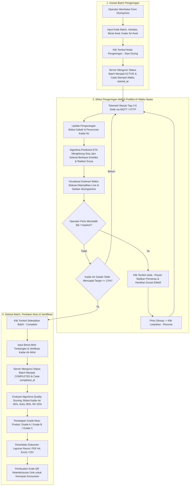
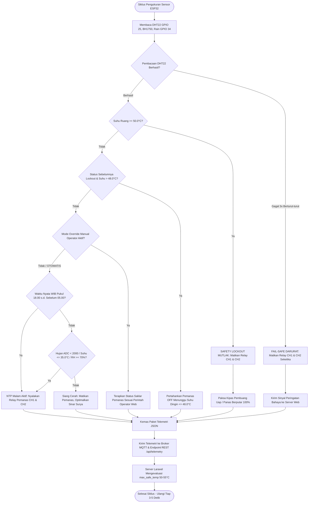

# 📜 Dokumen Pendaftaran Hak Kekayaan Intelektual (HKI)
## Deskripsi Ciptaan Program Komputer & Spesifikasi Inovasi Sistem Cerdas
### Smart Room Dryer Hanjeli — IoT Greenhouse Monitoring & Control System

> **Klasifikasi Dokumen**: Deskripsi Resmi Ciptaan Program Komputer (Format Surat Permohonan Hak Cipta DJKI Kemenkumham RI) & Draft Spesifikasi Inovasi Paten Sederhana  
> **Kategori Ciptaan**: Program Komputer (Software Aplikasi Web, Backend Real-Time, & Embedded Firmware IoT)  
> **Tanggal Penyusunan**: 2026  
> **Lembaga Pengusul**: Center of Excellence Smart Telecommunication, Automation & System - Research Group (**CoE STAS-RG**)  
> **Mitra Lapangan**: Desa Wisata Hanjeli, Waluran Mandiri, Kab. Sukabumi, Jawa Barat  

---

## 📋 DAFTAR ISI

1. [Identitas Ciptaan & Data Pengusul](#1-identitas-ciptaan--data-pengusul)
2. [Uraian Singkat Gambar (Gambar 1 s.d. Gambar 7)](#2-uraian-singkat-gambar-gambar-1-sd-gambar-7)
3. [Latar Belakang & Urgensi Masalah Pascapanen Hanjeli](#3-latar-belakang--urgensi-masalah-pascapanen-hanjeli)
4. [Ringkasan Eksekutif & Karakteristik Inovasi (Novelty)](#4-ringkasan-eksekutif--karakteristik-inovasi-novelty)
5. [Spesifikasi Teknis & Arsitektur Perangkat Lunak](#5-spesifikasi-teknis--arsitektur-perangkat-lunak)
6. [Deskripsi Lengkap Blok Diagram Arsitektur Sistem (Gambar 7 dengan Nomor Referensi (1)-(14))](#6-deskripsi-lengkap-blok-diagram-arsitektur-sistem-gambar-7-dengan-nomor-referensi-1-14)
7. [Deskripsi Lengkap Diagram Alir Siklus Batch & AI ETA (Gambar 6)](#7-deskripsi-lengkap-diagram-alir-siklus-batch--ai-eta-gambar-6)
8. [Deskripsi Lengkap Diagram Alir Kontrol Suhu & Safety Cutoff (Gambar 5)](#8-deskripsi-lengkap-diagram-alir-kontrol-suhu--safety-cutoff-gambar-5)
9. [Deskripsi Modul Fungsional & Fitur Utama Aplikasi](#9-deskripsi-modul-fungsional--fitur-utama-aplikasi)
10. [Penggalan Kode Sumber Program Komputer (Source Code Samples)](#10-penggalan-kode-sumber-program-komputer-source-code-samples)
11. [Klaim Inovasi Paten Sederhana & Hak Cipta (Klaim 1 s.d. 8)](#11-klaim-inovasi-paten-sederhana--hak-cipta-klaim-1-sd-8)
12. [Surat Pernyataan Keaslian & Pengalihan Hak Cipta](#12-surat-pernyataan-keaslian--pengalihan-hak-cipta)

---

## 1. IDENTITAS CIPTAAN & DATA PENGUSUL

### 1.1. Data Ciptaan Program Komputer
- **Judul Ciptaan**:  
  *Sistem Cerdas Otomasi dan Pemantauan Pengeringan Biji Hanjeli Berbasis Agro-Industrial IoT, WebSockets Real-Time, dan Web Bluetooth (BLE)*  
  *(Smart Room Dryer Hanjeli Web & Embedded System)*
- **Jenis Ciptaan**: Program Komputer (Perangkat Lunak Aplikasi Web & Firmware Mikrokontroler)
- **Sub-Jenis**: Sistem Pemantauan dan Pengendalian Otomasi Industri Pertanian Berbasis Internet of Things (IoT)
- **Bahasa Pemrograman Utama**: PHP (v8.3+ / Laravel 12 Framework), JavaScript (Vue.js 3.5, Node.js), C++ (Arduino ESP32 Core), SQL, HTML5, CSS3 (Tailwind CSS v4).
- **Tanggal Pertama Kali Diumumkan**: 26 Oktober 2026
- **Kota Pertama Kali Diumumkan**: Sukabumi / Bandung, Jawa Barat, Republik Indonesia
- **Sektor Penerapan**: Agro-Industri, Ketahanan Pangan Fungsional, Smart Agriculture, Desa Wisata Mandiri.

### 1.2. Data Pencipta
- **Pencipta Utama**:  
  Nama: **Fatin Tsani**  
  Afiliasi: Center of Excellence Smart Telecommunication, Automation & System - Research Group (**CoE STAS-RG**)  
  Peran: Perancang Arsitektur Perangkat Lunak, Pengembang Backend Laravel, Pengembang Frontend Vue.js, Perancang Algoritma Kontrol Firmware ESP32.
- **Institusi Peneliti / Pengembang**:  
  **Center of Excellence Smart Telecommunication, Automation & System - Research Group (CoE STAS-RG)**
- **Mitra Pemberdayaan Lapangan**:  
  **Desa Wisata Hanjeli**, Jl. Pamoyan, Waluran Mandiri, Kec. Waluran, Kabupaten Sukabumi, Jawa Barat 43175, Indonesia.

---

## 2. URAIAN SINGKAT GAMBAR (GAMBAR 1 S.D. GAMBAR 7)

Berikut adalah daftar dan uraian singkat gambar lampiran spesifikasi teknis ciptaan yang disusun secara berurutan:

- **Gambar 1**: Tampilan Antarmuka Dasbor Monitoring & Telemetri Real-Time, yang memperlihatkan visualisasi indikator instrumen melingkar (*radial gauges*) untuk suhu ruang, kelembapan udara relatif, intensitas radiasi matahari, kadar air biji hanjeli, serta indikator multi-koneksi jaringan (*live network indicator*).
- **Gambar 2**: Visualisasi Grafik Analitik Interaktif Multi-Sumbu Riwayat Pengeringan, yang memperlihatkan kurva fluktuasi suhu internal/eksternal, kelembapan udara, intensitas cahaya surya, dan estimasi susut bobot gabah dengan selector rentang waktu dinamis.
- **Gambar 3**: Kartu Kendali Aktuator Cerdas Dual-Channel (*Actuator Control Card*), yang memperlihatkan antarmuka pengalihan mode Otomatis/Manual, saklar togol individual Pemanas Saluran 1 (`GPIO 26`), Pemanas Saluran 2 (`GPIO 27`), saklar master *Auxiliary Heater*, kendali kipas, serta tombol pemutus darurat (*Emergency Cut-Off*).
- **Gambar 4**: Antarmuka Pusat Manajemen Armada IoT & Pembaruan Firmware Jarak Jauh (*OTA Firmware Management*) pada Portal Administrator, yang memperlihatkan 7 sub-modul kendali node IoT, validasi token keamanan, repositori biner `.bin`, dan penampil kode sumber Arduino.
- **Gambar 5**: Diagram Alir Logika Kontrol Pemanas PTC & Mekanisme Pengaman Termal Berlapis (*Dual-Tier Safety Architecture*), yang memperlihatkan percabangan evaluasi keselamatan mikrokontroler (hard-lockout $\ge 50.0^\circ\text{C}$, recovery $\le 48.0^\circ\text{C}$), integrasi batas aman server (`max_safe_temp` $50.0^\circ\text{C} - 55.0^\circ\text{C}$), jadwal malam waktu nyata NTP WIB (pukul 18.00 hingga sebelum 05.00 WIB), dan auto-trigger presipitasi hujan.
- **Gambar 6**: Diagram Alir Siklus Manajemen Batch Pengeringan, yang memperlihatkan alur kerja sistem mulai dari inisiasi batch baru, **penghitungan estimasi sisa waktu pengeringan (*Predictive ETA*) berbasis kinetika difusi lapisan tipis yang dijalankan secara berkala selama batch berstatus aktif**, hingga prosedur penyelesaian batch (*complete*) yang mengunci data dan melakukan penilaian mutu komposit (*Quality Scoring Grade A/B/C*) serta penerbitan sertifikat QR ketertelusuran publik.
- **Gambar 7**: Blok Diagram Arsitektur Sistem Terintegrasi End-to-End dari ESP32 hingga Antarmuka Web, yang memperlihatkan hubungan fungsional antara perangkat mikrokontroler, modul sensor, modul aktuator relai, jalur komunikasi nirkabel, broker MQTT, server backend Laravel, server WebSocket Reverb, basis data, dan klien peramban web dengan penomoran referensi **(1) sampai (14)**.

---

## 3. LATAR BELAKANG & URGENSI MASALAH PASCAPANEN HANJELI

Hanjeli (*Coix lacryma-jobi L.*) merupakan komoditas pangan fungsional unggulan asal Waluran, Kabupaten Sukabumi yang memiliki kandungan gizi tinggi, kaya serat larut, bebas gluten (*gluten-free*), dan memiliki indeks glikemik rendah. Namun, proses pascapanen biji hanjeli menghadapi tantangan kritis pada fase pengeringan:

1. **Struktur Biji yang Padat dan Berkadar Air Awal Tinggi**:  
   Biji hanjeli basah hasil panen memiliki kadar air sekitar $24\% - 28\%$. Untuk dapat disimpan aman tanpa risiko pembusukan dan memenuhi standar mutu giling prima (SNI), kadar air harus diturunkan secara bertahap hingga mencapai kadar air kesetimbangan $\le 12\% - 14\%$.
2. **Ketergantungan Cuaca pada Pengeringan Tradisional (*Sun Drying*)**:  
   Penjemuran tradisional di lantai terbuka sangat rentan terhadap fluktuasi cuaca, mendung, dan curah hujan tinggi di wilayah pegunungan Sukabumi. Proses penjemuran sering memakan waktu 5 hingga 7 hari, memicu tumbuhnya jamur pembusuk dan racun mikotoksin (*aflatoksin*) yang berbahaya bagi kesehatan manusia.
3. **Fluktuasi Suhu dan Lonjakan Kelembapan Malam Hari**:  
   Pada malam hari, kelembapan relatif udara perkebunan dapat melonjak melampaui $85\%$. Kondisi ini memicu fenomena penyerapan uap air kembali (*moisture re-absorption*) oleh biji yang sudah setengah kering, memperpanjang durasi pengeringan dan merusak viabilitas benih.
4. **Ketiadaan Data Objektif & Kendali Mikroiklim Presisi**:  
   Petani tidak memiliki alat kendali otomatis untuk menstabilkan suhu ruang pada zona optimal ($40^\circ\text{C} - 50^\circ\text{C}$), membuang udara jenuh, atau mengukur laju susut bobot gabah secara ilmiah.

Untuk mengatasi permasalahan tersebut, dirancang sistem terpadu **Smart Room Dryer Hanjeli** yang memadukan fasilitas rumah pengering polikarbonat, mikrokontroler IoT, sensor lingkungan ganda, pemanas keramik PTC ganda (*Dual Relay PTC Heater*), kipas sirkulasi, serta platform web analitik dengan latensi sub-detik.

---

## 4. RINGKASAN EKSEKUTIF & KARAKTERISTIK INOVASI (NOVELTY)

Program komputer ini memiliki kebaruan teknis distingtif (*novelty*) yang membedakannya secara signifikan dari sistem otomasi pertanian konvensional:

1. **Fleksibilitas Ingesti Telemetri & Dual-Path Endpoint**:
   - Mendukung transmisi data telemetri melalui broker MQTT (`hanjeli/greenhouse/telemetry`) dengan format paket terstruktur yang memuat identifikasi perangkat dan stempel waktu.
   - Mendukung jalur transmisi HTTP REST melalui endpoint utama **`POST /api/telemetry`** (yang digunakan langsung pada firmware ESP32) serta alias **`POST /api/telemetry/ingest`** pada backend Laravel.
   - Pada jalur HTTP REST, identifikasi perangkat diverifikasi secara aman melalui header token autentikasi (`X-Device-Token` atau `X-API-Key`) dengan pencatatan stempel waktu otomatis di sisi server (`recorded_at = Carbon::now()`), memberikan fleksibilitas integrasi tanpa membebani mikrokontroler.
2. **Arsitektur Pengamanan Termal Berlapis (*Dual-Tier Safety Architecture*)**:
   - **Tingkat Perangkat Keras (*Hardware / Edge Tier*)**: Mikrokontroler ESP32 memiliki proteksi interlock mandiri (*hard-lockout*) yang secara mutlak memutus arus relai pemanas jika suhu fisik $\ge 50.0^\circ\text{C}$, dan hanya mengizinkan pemulihan aktif jika suhu telah mendingin $\le 48.0^\circ\text{C}$ (histeresis $2.0^\circ\text{C}$). Sistem juga memutus pemanas seketika jika sensor DHT22 mengalami kegagalan pembacaan 3 kali berturut-turut. Logika ini beroperasi independen tanpa ketergantungan koneksi internet.
   - **Tingkat Server (*Cloud / Backend Tier*)**: Server backend Laravel secara kontinu mengevaluasi nilai telemetri masuk terhadap parameter ambang suhu aman maksimum (`max_safe_temp`) yang dapat dikonfigurasi dinamis oleh Administrator dalam rentang **$50.0^\circ\text{C}$ hingga $55.0^\circ\text{C}$**. Jika ambang batas terlampaui, server secara otomatis mengunci status aktuator (*OVER_TEMPERATURE_LOCKOUT*), menyiarkan event darurat melalui Laravel Reverb WebSocket, dan mendistribusikan notifikasi darurat multi-saluran (WhatsApp, Telegram, Email).
3. **Pengendalian Cerdas Dual Relay Pemanas Keramik PTC**:
   - Mengendalikan dua kanal relai terpisah: Saluran 1 (`RELAY_CH1` pada `GPIO 26`) untuk pemanas utama dan Saluran 2 (`RELAY_CH2` pada `GPIO 27`) untuk pemanas bantu/cadangan.
   - Terintegrasi dengan sinkronisasi waktu nyata **NTP WIB**, di mana pemanas otomatis beroperasi pada malam hari mulai **pukul 18.00 hingga sebelum pukul 05.00 WIB** (pukul 18:00 sampai 04:59 WIB).
   - Di luar jadwal malam, pemanas otomatis dipicu aktif jika terdeteksi hujan (*rain sensor* ADC < 2000), suhu udara dingin ($\le 35.0^\circ\text{C}$), atau kelembapan udara jenuh ($\ge 70.0\%$).
4. **Prediksi Waktu Selesai (*Predictive ETA Engine*) pada Batch Aktif**:
   - Pemodelan kinetika difusi air lapisan tipis (*thin-layer drying*) dipadukan dengan data intensitas radiasi matahari riil yang dihitung secara berkala selama siklus batch berstatus aktif (`ACTIVE`).
5. **Penilaian Mutu Objektif & Sertifikasi QR Ketertelusuran (*Quality Scoring & Traceability QR*)**:
   - Saat operator menyelesaikan batch pengeringan (*Complete Batch*), sistem mengunci data rekaman dan menghitung skor mutu komposit berbobot:
     $$\text{Skor Mutu} = (S_{\text{kadar air}} \times 45\%) + (S_{\text{stabilitas suhu}} \times 35\%) + (S_{\text{kestabilan RH}} \times 20\%)$$
   - Mengklasifikasikan hasil panen secara transparan menjadi **Grade A** (Skor $\ge 85$), **Grade B** (Skor $70 - 84$), atau **Grade C** (Skor $< 70$), serta menerbitkan sertifikat digital dengan kode QR ketertelusuran yang dapat diakses publik.
6. **Transmisi Tri-Mode Bebas Dependensi Eksternal**:
   - Mengintegrasikan saluran Wi-Fi (MQTT & WebSockets Reverb :8080), Web Bluetooth API (BLE) untuk konfigurasi lapangan langsung dari peramban, serta pembacaan log diagnostik UART Serial 115200 baud pada stasiun kerja.

---

## 5. SPESIFIKASI TEKNIS & ARSITEKTUR PERANGKAT LUNAK

Perangkat lunak dibangun dengan spesifikasi teknologi modern dan standar industri:

| Komponen Arsitektur | Teknologi / Standar yang Digunakan | Peran Fungsional dalam Sistem |
| :--- | :--- | :--- |
| **Backend Framework** | Laravel versi 12/13 (PHP 8.3+) | Routing RESTful API, ORM Eloquent, Job Queue, Scheduler, dan Service Layer |
| **WebSocket Engine** | Laravel Reverb (Port `8080`, RFC 6455) | Server WebSocket terpasang (*native*) berlatensi sub-detik untuk pembaruan telemetri |
| **Basis Data** | MySQL 8.4 / SQLite | Penyimpanan data relasional akun, parameter, batch, dan time-series sensor |
| **Frontend Framework**| Vue.js 3.5 (Composition API & Pinia) | Antarmuka interaktif Single Page Application (SPA) dan Progressive Web App (PWA) |
| **Build Tool & Styling**| Vite 6 / Vite 8 & Tailwind CSS v4 | Kompilasi modul cepat dan implementasi standar desain industri Zero-Shadow |
| **Protokol Telemetri** | MQTT (HiveMQ / Mosquitto Port `1883`) | Protokol komunikasi ringan (*pub/sub*) untuk perangkat IoT berdaya rendah |
| **Embedded Firmware** | Arduino C++ (ESP32 Core) | Logika kontrol sensor, relay, kalkulasi histeresis, dan sinkronisasi waktu NTP |
| **Peramban Klien** | Google Chrome, Edge, Safari (Chromium) | Mendukung W3C Web Bluetooth API, Web Serial API, dan WebAuthn Passkeys |

---

## 6. DESKRIPSI LENGKAP BLOK DIAGRAM ARSITEKTUR SISTEM (GAMBAR 7 DENGAN NOMOR REFERENSI (1)-(14))

Sesuai dengan ketentuan standar dokumen HKI/Paten, blok diagram arsitektur sistem pada **Gambar 7** memuat komponen-komponen perangkat lunak dan perangkat keras IoT yang terhubung secara fungsional menggunakan nomor acuan referensi numerik **(1) sampai (14)**:

```
┌─────────────────────────────────────────────────────────────────────────────────┐
│             FASILITAS GREENHOUSE PENGERING HANJELI (BAGIAN LAPANGAN)            │
│                                                                                 │
│   (2) Sensor Suhu & RH DHT22  ───┐                                              │
│                                  │ (GPIO 25)                                    │
│   (3) Sensor Radiasi Surya    ───┼─── (GPIO 21/22) ──► ┌────────────────────┐   │
│       BH1750 (Lux)               │                     │                    │   │
│                                  │                     │                    │   │
│   (4) Sensor Hujan Analog     ───┼─── (GPIO 34 ADC) ─► │ (1) Mikrokontroler │   │
│                                  │                     │     ESP32 Core     │   │
│   (5) Penampil Karakter       ◄──┴─── (GPIO 21/22) ─── │                    │   │
│       Layar LCD 20x4 I2C                               │                    │   │
│                                                        └─────────┬──────────┘   │
│                                  ┌───────────────────────────────┤              │
│   (6) Relai Saluran 1 (PTC 1) ◄──┼── (GPIO 26 Digital Output) ───┤              │
│                                  │                               │              │
│   (7) Relai Saluran 2 (PTC 2) ◄──┴── (GPIO 27 Digital Output) ───┘              │
│                                                                                 │
│                                  ┌───────────────────────────────┐              │
│                                  │ (8) Modul Wi-Fi Nirkabel ESP32│              │
└──────────────────────────────────┴───────────────┬───────────────┴──────────────┘
                                                   │
                  ┌────────────────────────────────┴────────────────────────────────┐
                  │ Transmisi Jaringan Internet (MQTT / HTTP Ingestion)             │
                  ▼                                                                 ▼
   ┌──────────────────────────────┐                                ┌──────────────────────────────┐
   │ (9) Broker Pesan MQTT        │                                │ (11) Server Aplikasi & REST  │
   │     (HiveMQ Port 1883)       │                                │      API Backend Laravel     │
   └──────────────┬───────────────┘                                │      - POST /api/telemetry   │
                  │                                                │      - POST /api/telemetry/  │
                  ▼                                                │        ingest (Alias)        │
   ┌──────────────────────────────┐                                └──────────────┬───────────────┘
   │ (10) Worker Ingesti MQTT     │                                               │
   │      Daemon (Artisan CLI)    ├───────────────────────────────────────────────┤
   └──────────────┬───────────────┘                                               │
                  │                                                               │
                  ▼                                                               ▼
   ┌──────────────────────────────┐                                ┌──────────────────────────────┐
   │ (12) Server WebSocket        │                                │ (13) Basis Data Sistem       │
   │      Real-Time (Reverb :8080)│                                │      (MySQL 8.4 / SQLite)    │
   └──────────────┬───────────────┘                                └──────────────┬───────────────┘
                  │                                                               │
                  └───────────────────────────────┬───────────────────────────────┘
                                                  │ Push Real-Time & REST API
                                                  ▼
                                   ┌──────────────────────────────┐
                                   │ (14) Klien Antarmuka Pengguna│
                                   │      (Vue.js 3.5 SPA & PWA)  │
                                   └──────────────────────────────┘
```

### Uraian Nomor Referensi Elemen Gambar 7:
- **(1) Mikrokontroler ESP32**: Unit pemroses lokal (*edge computing*) berinti ganda (*dual-core Xtensa LX6 240 MHz*) yang mengeksekusi pembacaan sensor dan interlock keselamatan fisik.
- **(2) Sensor Suhu dan Kelembapan Relatif Digital (DHT22)**: Terhubung ke pin `GPIO 25` untuk mengukur suhu ($^\circ\text{C}$) dan kelembapan (% RH) udara dalam ruang pengering.
- **(3) Sensor Radiasi Cahaya Surya (BH1750)**: Terhubung ke bus I2C (`GPIO 21 SDA` dan `GPIO 22 SCL`) untuk mengukur intensitas cahaya matahari dalam satuan Lux.
- **(4) Sensor Presipitasi Hujan**: Terhubung ke pin `GPIO 34 ADC` untuk mendeteksi pembasahan atap ruang pengering (ambang hujan ADC $< 2000$).
- **(5) Penampil Karakter Layar LCD 20x4 I2C**: Terhubung ke bus I2C (alamat `0x27`) untuk menampilkan diagnostik operasional dan nilai sensor langsung di greenhouse.
- **(6) Relai Saluran 1 (Pemanas PTC 1)**: Modul saklar digital terhubung ke pin `GPIO 26` untuk memutus atau mengalirkan arus listrik ke elemen pemanas keramik PTC utama.
- **(7) Relai Saluran 2 (Pemanas PTC 2)**: Modul saklar digital terhubung ke pin `GPIO 27` untuk memutus atau mengalirkan arus listrik ke elemen pemanas keramik PTC bantu/cadangan.
- **(8) Modul Wi-Fi Nirkabel ESP32**: Perangkat keras transceiver nirkabel terintegrasi 2.4 GHz untuk memancarkan paket data telemetri ke server awan.
- **(9) Broker Pesan MQTT**: Server perantara pesan *publish/subscribe* (HiveMQ / Mosquitto port 1883) pada topik telemetri dan kendali aktuator.
- **(10) Worker Ingesti MQTT Daemon**: Proses latar belakang (*Artisan Console Worker*) yang berlangganan (*subscribe*) pada broker MQTT dan memproses pesan masuk.
- **(11) Server Aplikasi & REST API Backend (Laravel 12/13)**: Mesin pemroses utama yang menyediakan endpoint RESTful API, validasi token keamanan perangkat (`X-Device-Token`), serta pengelolaan logika bisnis pengeringan.
- **(12) Server WebSocket Real-Time (Laravel Reverb)**: Server perantara WebSocket berbasis protokol RFC 6455 (port 8080) yang menyiarkan paket telemetri ke antarmuka pengguna tanpa membebani basis data.
- **(13) Basis Data Sistem (MySQL 8.4 / SQLite)**: Media penyimpanan data relasional terstruktur mencakup tabel pengguna, batch pengeringan, pengaturan parameter, serta rekaman deret waktu telemetri.
- **(14) Klien Antarmuka Pengguna (Vue.js 3.5 SPA & PWA)**: Aplikasi web responsif berbasis peramban (*web browser*) yang menampilkan dasbor instrumen pemantauan, grafik analitik, kartu kendali aktuator, dan verifikasi sertifikat mutu.

---

## 7. DESKRIPSI LENGKAP DIAGRAM ALIR SIKLUS BATCH & AI ETA (GAMBAR 6)

Diagram alir pada **Gambar 6** mendokumentasikan siklus hidup batch pengeringan hanjeli dengan penekanan pada waktu eksekusi prediksi kinetika dan evaluasi kualitas:



> **Penegasan Hubungan Fungsional**:  
> Estimasi sisa waktu pengeringan (*Predictive ETA*) dihitung secara berulang dan dinamis **hanya pada saat batch berstatus AKTIF (`ACTIVE`)**. Sebaliknya, saat batch **DISELESAIKAN (`COMPLETED`)**, sistem tidak lagi menjalankan estimasi waktu, melainkan mengunci rekam jejak, menghitung skor mutu objektif (*Quality Score Grade A/B/C*), serta menghasilkan laporan audit dan kode QR ketertelusuran publik.

---

## 8. DESKRIPSI LENGKAP DIAGRAM ALIR KONTROL SUHU & SAFETY CUTOFF (GAMBAR 5)

Diagram alir pada **Gambar 5** memperlihatkan arsitektur keselamatan termal mikrokontroler dan server:



---

## 9. DESKRIPSI MODUL FUNGSIONAL & FITUR UTAMA APLIKASI

Perangkat lunak terdiri dari kumpulan modul fungsional yang saling terintegrasi:

1. **Modul Autentikasi Pengguna & Keamanan Multi-Faktor**:
   - Memvalidasi kredensial pengguna berbasis token Sanctum.
   - Mendukung autentikasi biometrik W3C **WebAuthn / Passkeys** (sidik jari, pengenalan wajah Face ID, Windows Hello).
   - Pengendalian hak akses berbasis peran (*Role-Based Access Control*): Hak akses Administrator untuk manajemen sistem dan Operator untuk aktivitas pengeringan.
2. **Modul Pemantauan Telemetri Real-Time**:
   - Mengonsumsi data telemetri secara instan tanpa membebani browser melalui langganan kanal WebSocket Laravel Reverb (`greenhouse.telemetry`).
   - Menyajikan metrik iklim mikro internal dan eksternal, indeks intensitas radiasi matahari ($W/m^2$ dan Lux), kadar air gabah, serta bobot susut terukur.
3. **Modul Kendali Aktuator Cerdas**:
   - Menyediakan tombol pemutus darurat (*Emergency Cut-Off*) yang mematikan seluruh saluran pemanas seketika.
   - Menyediakan saklar independen untuk Saluran 1 (`GPIO 26`) dan Saluran 2 (`GPIO 27`), serta saklar gabungan (*Master Aux Heater*).
4. **Modul Pusat Kendali Armada IoT 7 Sub-Modul Admin (`/admin/devices`)**:
   - Mengelola keamanan token perangkat (`security`), memicu pembaruan program jarak jauh (`ota`), mengarsipkan file biner rilis firmware (`releases`), memantau latensi dan *packet drop* sensor (`sensors`), menguji saklar relai fisik (`actuators`), menampilkan katalog pinout (`catalog`), dan menyediakan penampil kode sumber mikrokontroler (`arduino`).
5. **Modul Verifikasi Ketertelusuran Publik (*Farm-to-Table Traceability*)**:
   - Endpoint publik `/verify/:batchCode` yang dapat diakses oleh konsumen akhir melalui pemindaian kode QR pada kemasan produk tanpa perlu melakukan login akun.

---

## 10. PENGGALAN KODE SUMBER PROGRAM KOMPUTER (SOURCE CODE SAMPLES)

Sebagai pemenuhan persyaratan substantif pendaftaran Hak Cipta Program Komputer pada DJKI Kemenkumham RI, berikut dilampirkan penggalan kode sumber asli sistem:

### 10.1. Firmware Mikrokontroler ESP32 — Logika Pemanas Dual-Channel & Safety Interlock
*Berkas: `docs/esp32_smart_dryer_hardware/esp32_smart_dryer_hardware.ino`*

```cpp
#define RELAY_CH1     26     // Relay Channel 1: Heater Utama
#define RELAY_CH2     27     // Relay Channel 2: Heater Bantu / Cadangan
#define DHTPIN        25     // Sensor Suhu & Kelembapan DHT22
#define RAIN_PIN      34     // Sensor Hujan Analog ADC
#define STATUS_LED    2      // Indikator Konektivitas

// Aturan Histeresis Suhu Standar Keselamatan Fisik
const float MAX_TEMP_C     = 50.0; // Batas Suhu Kritis (Heater Wajib OFF / Lockout)
const float RESTART_TEMP_C = 48.0; // Suhu Pemulihan (Heater Boleh Aktif Kembali)

void updateHeaterLogic(float temp, float hum, bool isRaining, int currentHour) {
    // 1. Safety Lockout Mutlak jika Suhu Fisik >= 50.0°C
    if (temp >= MAX_TEMP_C) {
        lockoutTriggered = true;
        setDualHeaters(false, false);
        heaterReason = "Safety Lockout: Overheat >= 50C";
        return;
    }

    // 2. Pemulihan dari Lockout hanya jika suhu sudah mendingin <= 48.0°C
    if (lockoutTriggered) {
        if (temp <= RESTART_TEMP_C) {
            lockoutTriggered = false;
        } else {
            setDualHeaters(false, false);
            heaterReason = "Lockout Active: Cooling down to 48C";
            return;
        }
    }

    // 3. Mode Manual Override jika diatur secara eksplisit oleh Operator Web
    if (manualOverrideActive) {
        setDualHeaters(manualCh1State, manualCh2State);
        return;
    }

    // 4. Jadwal Otomatis Malam NTP WIB (Mulai pukul 18.00 hingga sebelum 05.00 WIB)
    bool isNightSchedule = (currentHour >= 18 || currentHour < 5);
    bool climateDemand   = isRaining || (temp <= 35.0) || (hum >= 70.0);

    if (isNightSchedule || climateDemand) {
        setDualHeaters(true, true);
        heaterReason = isNightSchedule ? "NTP Night Schedule Active" : "Climate Demand Triggered";
    } else {
        setDualHeaters(false, false);
        heaterReason = "Daytime Passive Solar Drying";
    }
}
```

### 10.2. Pengendali Ingesti Telemetri & Evaluasi Batas Aman (Backend Laravel)
*Berkas: `app/Http/Controllers/Api/TelemetryController.php`*

```php
public function ingest(Request $request, \App\Services\MqttService $mqttService): JsonResponse
{
    // 1. Otentikasi Perangkat Hardware melalui Header Token
    $token = $request->header('X-Device-Token') 
        ?? $request->header('X-Device-Key')
        ?? $request->header('X-API-Key')
        ?? $request->input('device_token')
        ?? $request->input('api_key');

    $validDevice = \App\Models\Device::where('device_token', $token)
        ->where('is_active', true)
        ->first();

    // 2. Normalisasi Data Sensor Masuk (tempInternal dan humidityInternal)
    $tempInternal = $request->input('tempInternal', $request->input('temp_internal', $request->input('temperature')));
    $humidityInternal = $request->input('humidityInternal', $request->input('humidity_internal', $request->input('humidity')));

    if ($tempInternal === null || $humidityInternal === null) {
        return response()->json([
            'success' => false,
            'message' => 'Suhu internal dan kelembapan internal wajib disertakan.',
        ], 422);
    }

    // 3. Evaluasi Logika Pemanas & Jadwal Malam NTP WIB (18.00 hingga sebelum 05.00 WIB)
    $currentHourWib = \Carbon\Carbon::now('Asia/Jakarta')->hour;
    $isNightSchedule = ($currentHourWib >= 18 || $currentHourWib < 5);
    $isHeaterOn = $request->boolean('heaterStatus', ($isNightSchedule || (float)$tempInternal <= 35.0));

    $payload = [
        'deviceId'         => $request->input('deviceId', $validDevice?->code ?? 'ESP32-HANJELI-01'),
        'tempInternal'     => (float) $tempInternal,
        'humidityInternal' => (float) $humidityInternal,
        'heaterStatus'     => $isHeaterOn,
        'heaterCh1Status'  => $request->boolean('heaterCh1Status', $isHeaterOn),
        'heaterCh2Status'  => $request->boolean('heaterCh2Status', $isHeaterOn),
        'isRaining'        => $request->boolean('is_raining', false),
    ];

    // Proses data dan evaluasi batas suhu kritis server (max_safe_temp)
    $telemetry = $mqttService->processTelemetryPayload($payload);

    return response()->json([
        'success'    => true,
        'id'         => $telemetry->id,
        'deviceId'   => $payload['deviceId'],
        'recordedAt' => now()->toIso8601String(),
        'actuators'  => \App\Models\ActuatorState::first()
    ], 201);
}
```

---

## 11. KLAIM INOVASI PATEN SEDERHANA & HAK CIPTA (KLAIM 1 S.D. 8)

Berikut adalah butir-butir rumusan klaim invensi ciptaan:

### Klaim 1:
Suatu sistem cerdas pemantauan dan pengeringan biji hanjeli pascapanen berbasis rumah pengering pintar (*smart greenhouse dryer*), yang terdiri dari:
- sebuah ruang pengering beratap polikarbonat tembus pandang penangkap radiasi surya;
- sekumpulan sensor lingkungan yang mencakup sensor suhu dan kelembapan udara digital internal (DHT22), sensor radiasi intensitas cahaya matahari (BH1750), dan sensor presipitasi air hujan analog;
- unit pemanas keramik PTC yang dikendalikan melalui sepasang saklar relai fisik (*Dual Relay Saluran 1 dan Saluran 2*);
- sebuah mikrokontroler (*edge device*) terprogram yang mengintegrasikan pengatur waktu nyata (*Real-Time NTP*) dan logika keselamatan termal; serta
- sebuah server backend web yang terhubung secara sub-detik melalui protokol pesan MQTT dan server WebSocket dua arah (*Laravel Reverb*).

### Klaim 2:
Sistem menurut klaim 1, di mana pengiriman paket data telemetri sensor dari mikrokontroler ke server backend dapat dilakukan secara fleksibel melalui dua saluran alternatif:
- saluran pertama melalui protokol broker MQTT yang memuat identifikasi perangkat dan stempel waktu di dalam struktur muatan JSON; atau
- saluran kedua melalui protokol HTTP REST pada endpoint **`POST /api/telemetry`** atau alias **`POST /api/telemetry/ingest`**, di mana identifikasi perangkat divalidasi melalui token keamanan pada tajuk permintaan (*header request*) dan stempel waktu dicatat secara otomatis di sisi server saat paket diterima.

### Klaim 3:
Sistem menurut klaim 1, di mana unit pemanas keramik PTC dikendalikan melalui relai saluran 1 (`GPIO 26`) sebagai pemanas utama dan relai saluran 2 (`GPIO 27`) sebagai pemanas bantu/cadangan, yang dapat diaktifkan secara mandiri maupun serentak melalui tombol kendali terpadu pada antarmuka web.

### Klaim 4:
Sistem menurut klaim 3, di mana relai pemanas saluran 1 dan relai pemanas saluran 2 diaktifkan secara otomatis pada siklus malam hari mulai **pukul 18.00 hingga sebelum pukul 05.00 WIB**, atau di luar jadwal tersebut saat terdeteksi presipitasi hujan, suhu ruang dingin $\le 35.0^\circ\text{C}$, atau kelembapan udara jenuh $\ge 70.0\%$.

### Klaim 5:
Sistem menurut klaim 1, di mana mekanisme keselamatan termal beroperasi secara berlapis (*dual-tier safety architecture*), yang meliputi:
- pengaman tingkat mikrokontroler dengan batas putus mutlak (*hard-lockout*) jika suhu fisik $\ge 50.0^\circ\text{C}$ dan histeresis pemulihan aktif kembali jika suhu mendingin $\le 48.0^\circ\text{C}$; serta
- pengaman tingkat server backend yang memantau batas suhu aman maksimum (`max_safe_temp`) yang dapat dikonfigurasi dinamis oleh administrator dalam rentang **$50.0^\circ\text{C}$ hingga $55.0^\circ\text{C}$** untuk mengunci status aktuator dan memancarkan notifikasi peringatan darurat multi-saluran.

### Klaim 6:
Sistem menurut klaim 1, di mana mikrokontroler terhubung ke stasiun kerja untuk pemantauan log diagnostik satu arah melalui komunikasi kabel serial UART 115200 baud, sementara seluruh perintah kendali aktuator dua arah diterima mikrokontroler melalui saluran jaringan MQTT dan respons transaksi HTTP.

### Klaim 7:
Suatu metode pemantauan dan pengendalian pengeringan biji hanjeli berbasis sistem cerdas mikrokontroler dan server, dicirikan oleh tahapan langkah:
1. membaca data parameter iklim mikro ruang pengering secara berkala;
2. memverifikasi integritas data sensor dan mengeksekusi prosedur *fail-safe* jika pembacaan sensor suhu mengalami kegagalan berturut-turut;
3. saat batch pengeringan berstatus aktif (`ACTIVE`), menghitung estimasi sisa waktu pengeringan (*Predictive ETA*) secara dinamis dan berkala berdasarkan laju difusi air lapisan tipis dan intensitas radiasi matahari;
4. mengendalikan relai pemanas saluran 1 dan saluran 2 secara otomatis pada malam hari mulai pukul 18.00 hingga sebelum pukul 05.00 WIB atau saat cuaca hujan dan dingin;
5. memutus arus relai pemanas secara mutlak seketika saat suhu ruang mencapai batas kritis mikrokontroler $50.0^\circ\text{C}$ atau batas toleransi aman server $50.0^\circ\text{C} - 55.0^\circ\text{C}$; serta
6. saat batch pengeringan diselesaikan oleh operator (`COMPLETED`), menghentikan penghitungan estimasi waktu, mengunci rekam jejak akhir, dan menghitung skor mutu komposit berbobot (*Quality Score*) untuk menghasilkan klasifikasi mutu Grade A, Grade B, atau Grade C serta menerbitkan kode verifikasi ketertelusuran QR publik.

### Klaim 8:
Metode menurut klaim 7, yang menyiarkan setiap perubahan telemetri dan status relai secara instan ke peramban pengguna dengan latensi sub-detik melalui server WebSocket terpasang *Laravel Reverb*.

---

## 12. SURAT PERNYATAAN KEASLIAN & PENGALIHAN HAK CIPTA

Dengan ini dinyatakan dengan sebenar-benarnya bahwa:
1. Karya ciptaan program komputer dan inovasi sistem cerdas berjudul **"Sistem Cerdas Otomasi dan Pemantauan Pengeringan Biji Hanjeli Berbasis Agro-Industrial IoT, WebSockets Real-Time, dan Web Bluetooth (BLE)"** adalah karya orisinal yang dirancang, diimplementasikan, dan diuji secara langsung oleh tim peneliti Center of Excellence STAS-RG bersama mitra pengelola Desa Wisata Hanjeli Waluran, Sukabumi.
2. Ciptaan ini bebas dari unsur penjiplakan (*plagiarisme*) dan tidak melanggar hak kekayaan intelektual milik pihak lain mana pun.
3. Dokumen deskripsi teknis ini disusun untuk dijadikan rujukan resmi permohonan pendaftaran **Hak Cipta Program Komputer** dan **Paten Sederhana** pada Direktorat Jenderal Kekayaan Intelektual (DJKI) Kementerian Hukum dan Hak Asasi Manusia Republik Indonesia.

---
*Ditetapkan dan disahkan secara resmi oleh Tim Pengembang CoE STAS-RG.*
