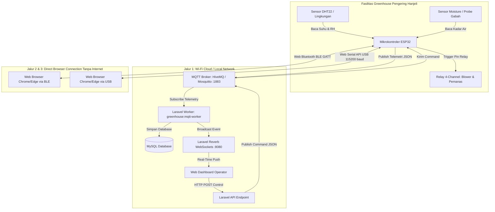

# 📡 Panduan Lengkap Koneksi Web ke Hardware IoT — Smart Room Dryer Hanjeli

Dokumen ini merupakan panduan resmi dan komprehensif mengenai **tata cara menghubungkan platform web Smart Room Dryer Hanjeli dengan perangkat keras fisik (*hardware mikrokontroler ESP32, sensor, dan aktuator relay*)**. 

Sistem ini dirancang dengan prinsip **Tri-Mode Connectivity**, memungkinkan web dan hardware berkomunikasi melalui 3 saluran transmisi fleksibel sesuai kondisi lapangan:
1. **Mode 1: Wi-Fi + MQTT & WebSockets (Online Jarak Jauh)**
2. **Mode 2: Web Bluetooth Low Energy / BLE (Nirkabel Direct Tanpa Internet)**
3. **Mode 3: Web Serial API (Kabel USB Langsung / Zero-Network Fallback)**

---

## 📑 Daftar Isi
1. [Arsitektur Alur Komunikasi Sistem](#1-arsitektur-alur-komunikasi-sistem)
2. [Spesifikasi Hardware & Skema Rangkaian (Wiring Diagram)](#2-spesifikasi-hardware--skema-rangkaian-wiring-diagram)
3. [Source Code Firmware ESP32 Lengkap](#3-source-code-firmware-esp32-lengkap)
4. [Persiapan & Konfigurasi Server / Backend (Laravel)](#4-persiapan--konfigurasi-server--backend-laravel)
5. [Panduan Operasional Menghubungkan Web ke Hardware](#5-panduan-operasional-menghubungkan-web-ke-hardware)
   - [5.1. Koneksi Melalui Wi-Fi & MQTT (Metode Utama)](#51-koneksi-melalui-wi-fi--mqtt-metode-utama)
   - [5.2. Koneksi Melalui Web Bluetooth (BLE Direct)](#52-koneksi-melalui-web-bluetooth-ble-direct)
   - [5.3. Koneksi Melalui Kabel USB (Web Serial API)](#53-koneksi-melalui-kabel-usb-web-serial-api)
6. [Pengujian Kontrol Aktuator (Dua Arah)](#6-pengujian-kontrol-aktuator-dua-arah)
7. [Panduan Troubleshooting & FAQ](#7-panduan-troubleshooting--faq)

---

## 1. Arsitektur Alur Komunikasi Sistem

Komunikasi antara Website dan Hardware berlangsung secara dua arah (*bidirectional*):
- **Upstream (Hardware $\rightarrow$ Web)**: Data telemetri sensor (suhu internal/eksternal, kelembaban, estimasi kadar air gabah hanjeli, radiasi surya) dikirim secara berkala.
- **Downstream (Web $\rightarrow$ Hardware)**: Perintah kontrol saklar dan aktuator (Exhaust Fan, Intake Blower, Kipas Sirkulasi, Pemanas PTC Bantu) dikirimkan saat operator menekan tombol kendali pada dashboard web.



---

## 2. Spesifikasi Hardware & Skema Rangkaian (Wiring Diagram)

### Komponen yang Digunakan
1. **Mikrokontroler**: ESP32 DevKit V1 (30-pin atau 38-pin).
2. **Sensor Suhu & Kelembaban Ruang**: DHT22 (AM2302) atau SHT31.
3. **Sensor Kadar Air Gabah / Analog**: Moisture Probe / Soil & Grain Moisture Sensor.
4. **Modul Aktuator**: Modul Relay 4-Channel 5V (Active LOW).
5. **Catu Daya**: Adaptor DC 5V 2A / Step-down Buck Converter LM2596.

### Tabel Pinout ESP32

| Komponen Hardware | Pin Komponen | Pin ESP32 (GPIO) | Catatan Khusus |
| :--- | :--- | :--- | :--- |
| **Sensor DHT22** | VCC | **3V3 / 5V** | Hubungkan ke sumber daya stabil |
| | DATA | **GPIO 4** | Tambahkan resistor pull-up 10kΩ ke VCC |
| | GND | **GND** | Ground bersama |
| **Relay 1 (Exhaust Fan)** | IN 1 | **GPIO 18** | Mengendalikan blower pembuang udara lembab |
| **Relay 2 (Intake Fan)** | IN 2 | **GPIO 19** | Mengendalikan kipas pemasok udara segar |
| **Relay 3 (Circulation Fan)**| IN 3 | **GPIO 21** | Mengendalikan kipas perata panas ruangan |
| **Relay 4 (Heater PTC)** | IN 4 | **GPIO 22** | Mengendalikan elemen pemanas listrik bantuan |
| **Relay VCC & GND** | VCC / GND | **5V / GND** | Sebaiknya gunakan catu daya eksternal 5V untuk relay |
| **Sensor Moisture (ADC)** | AOUT | **GPIO 34** | Pin Analog Input Only (ADC1) |
| **LED Indikator Status** | Anoda (+) | **GPIO 2** | LED Onboard ESP32 untuk indikator koneksi |

---

## 3. Source Code Firmware ESP32 Lengkap

Firmware berikut ditulis dalam bahasa **Arduino C++** dan telah mengintegrasikan koneksi **Wi-Fi + MQTT**, **Web Serial USB Output**, serta mekanisme proteksi aktuator:

```cpp
/*
 * ==============================================================================
 * SMART ROOM DRYER — DESA WISATA HANJELI
 * FIRMWARE KONEKSI HARDWARE KE WEB (ESP32 DUAL-MODE)
 * Wi-Fi MQTT + Web Serial USB Direct
 * ==============================================================================
 */

#include <WiFi.h>
#include <PubSubClient.h>
#include <ArduinoJson.h>
#include <DHT.h>

// ==============================================================================
// 1. PENGATURAN KREDENSIAL JARINGAN & BROKER
// ==============================================================================
// Ubah dengan nama Hotspot / Wi-Fi dan Kata Sandi Anda:
const char* WIFI_SSID     = "OPPO Reno";          // Contoh: Hotspot HP atau Wi-Fi Greenhouse
const char* WIFI_PASSWORD = "password1234";       // Kata sandi Wi-Fi

// Konfigurasi MQTT Broker (Default publik HiveMQ, sama dengan konfigurasi Laravel)
const char* MQTT_BROKER   = "broker.hivemq.com";
const int   MQTT_PORT     = 1883;
const char* DEVICE_ID     = "ESP32-HANJELI-01";   // Kode identitas perangkat

// Kontrak Topik MQTT
const char* TOPIC_TELEMETRY = "hanjeli/greenhouse/telemetry"; // Pengiriman sensor ke web
const char* TOPIC_CONTROL   = "hanjeli/greenhouse/control";   // Penerimaan kontrol dari web

// ==============================================================================
// 2. PIN HARDWARE & SENSOR
// ==============================================================================
#define DHTPIN 4
#define DHTTYPE DHT22
DHT dht(DHTPIN, DHTTYPE);

#define SENSOR_MOISTURE_ADC 34

// Pin Relay (Umumnya Active-LOW: LOW = ON, HIGH = OFF)
#define RELAY_EXHAUST_FAN  18
#define RELAY_INTAKE_FAN   19
#define RELAY_CIRC_FAN     21
#define RELAY_HEATER       22
#define STATUS_LED          2

// Status Aktual Aktuator
bool stateExhaust = false;
bool stateIntake  = false;
bool stateCirc    = false;
bool stateHeater  = false;

WiFiClient espClient;
PubSubClient mqttClient(espClient);

unsigned long lastSendMillis = 0;
const unsigned long SEND_INTERVAL = 3000; // Interval pengiriman: tiap 3 detik

// ==============================================================================
// 3. FUNGSI EKSEKUSI FISIK RELAY
// ==============================================================================
void applyRelays() {
  // Relay Active-LOW logic
  digitalWrite(RELAY_EXHAUST_FAN, stateExhaust ? LOW : HIGH);
  digitalWrite(RELAY_INTAKE_FAN,  stateIntake  ? LOW : HIGH);
  digitalWrite(RELAY_CIRC_FAN,    stateCirc    ? LOW : HIGH);
  digitalWrite(RELAY_HEATER,      stateHeater  ? LOW : HIGH);
}

// ==============================================================================
// 4. PENERIMAAN PERINTAH KONTROL DARI WEB (MQTT Callback)
// ==============================================================================
void mqttCallback(char* topic, byte* message, unsigned int length) {
  String payload = "";
  for (unsigned int i = 0; i < length; i++) {
    payload += (char)message[i];
  }

  Serial.println("\n[MQTT Command Masuk] Topik: " + String(topic));
  Serial.println("[Payload]: " + payload);

  StaticJsonDocument<512> doc;
  DeserializationError err = deserializeJson(doc, payload);
  if (err) {
    Serial.println("[MQTT Error] Gagal parsing JSON: " + String(err.c_str()));
    return;
  }

  // 1. Format Perintah Single Target: {"target":"EXHAUST_FAN","state":true}
  if (doc.containsKey("target")) {
    String target = doc["target"].as<String>();
    bool state = doc["state"].as<bool>();

    if (target == "EXHAUST_FAN")      stateExhaust = state;
    else if (target == "INTAKE_FAN")  stateIntake  = state;
    else if (target == "CIRC_FAN")    stateCirc    = state;
    else if (target == "AUX_HEATER")  stateHeater  = state;
  }
  // 2. Format Perintah Batch Status: {"exhaustFanStatus":true,"intakeFanStatus":false,...}
  else if (doc.containsKey("exhaustFanStatus")) {
    stateExhaust = doc["exhaustFanStatus"];
    stateIntake  = doc["intakeFanStatus"];
    stateCirc    = doc["circFanStatus"];
    stateHeater  = doc["auxHeaterStatus"];
  }

  // Terapkan perubahan ke pin relay
  applyRelays();
  Serial.println("✓ Status Relay berhasil diperbarui!");
}

// ==============================================================================
// 5. MANAJEMEN KONEKSI WI-FI & MQTT BROKER
// ==============================================================================
void connectWiFi() {
  if (WiFi.status() == WL_CONNECTED) return;

  Serial.print("[Wi-Fi] Menghubungkan ke SSID: ");
  Serial.println(WIFI_SSID);
  WiFi.mode(WIFI_STA);
  WiFi.begin(WIFI_SSID, WIFI_PASSWORD);

  int attempts = 0;
  while (WiFi.status() != WL_CONNECTED && attempts < 20) {
    delay(500);
    Serial.print(".");
    digitalWrite(STATUS_LED, !digitalRead(STATUS_LED));
    attempts++;
  }

  if (WiFi.status() == WL_CONNECTED) {
    digitalWrite(STATUS_LED, HIGH);
    Serial.println("\n✓ [Wi-Fi] Terhubung! IP ESP32: " + WiFi.localIP().toString());
  } else {
    Serial.println("\n⚠ [Wi-Fi] Belum terhubung. Sistem tetap menyalurkan telemetri via Web Serial USB.");
  }
}

void reconnectMQTT() {
  if (WiFi.status() != WL_CONNECTED || mqttClient.connected()) return;

  Serial.print("[MQTT] Menghubungkan ke broker: ");
  Serial.print(MQTT_BROKER);

  String clientId = "ESP32-Dryer-" + String(random(0xffff), HEX);
  if (mqttClient.connect(clientId.c_str())) {
    Serial.println(" -> Terhubung!");
    mqttClient.subscribe(TOPIC_CONTROL);
    Serial.println("✓ [MQTT] Berhasil subscribe topik: " + String(TOPIC_CONTROL));
  } else {
    Serial.print(" Gagal, rc=");
    Serial.print(mqttClient.state());
    Serial.println(" (Akan dicoba kembali pada iterasi berikutnya)");
  }
}

// ==============================================================================
// 6. SETUP UTAMA
// ==============================================================================
void setup() {
  Serial.begin(115200);
  delay(1000);

  Serial.println("\n========================================================");
  Serial.println("  SMART ROOM DRYER HANJELI — ESP32 HARDWARE ENGINE");
  Serial.println("========================================================");

  dht.begin();

  pinMode(STATUS_LED, OUTPUT);
  pinMode(RELAY_EXHAUST_FAN, OUTPUT);
  pinMode(RELAY_INTAKE_FAN, OUTPUT);
  pinMode(RELAY_CIRC_FAN, OUTPUT);
  pinMode(RELAY_HEATER, OUTPUT);

  // Default awal semua relay mati (HIGH pada active-low)
  applyRelays();

  // Inisialisasi Wi-Fi & MQTT
  connectWiFi();
  mqttClient.setServer(MQTT_BROKER, MQTT_PORT);
  mqttClient.setCallback(mqttCallback);
}

// ==============================================================================
// 7. LOOP UTAMA
// ==============================================================================
void loop() {
  // Pertahankan koneksi Wi-Fi dan MQTT jika memungkinkan
  if (WiFi.status() == WL_CONNECTED) {
    if (!mqttClient.connected()) {
      reconnectMQTT();
    } else {
      mqttClient.loop();
    }
  }

  // Baca perintah balik dari Web Serial API jika dicolok kabel USB ke laptop
  if (Serial.available()) {
    String serialInput = Serial.readStringUntil('\n');
    serialInput.trim();
    if (serialInput.length() > 0 && serialInput.startsWith("{")) {
      StaticJsonDocument<256> sDoc;
      if (!deserializeJson(sDoc, serialInput)) {
        if (sDoc.containsKey("target")) {
          String target = sDoc["target"].as<String>();
          bool state = sDoc["state"].as<bool>();
          if (target == "EXHAUST_FAN")     stateExhaust = state;
          else if (target == "INTAKE_FAN") stateIntake  = state;
          else if (target == "CIRC_FAN")   stateCirc    = state;
          else if (target == "AUX_HEATER") stateHeater  = state;
          applyRelays();
        }
      }
    }
  }

  // Pengiriman Telemetri Terjadwal (Tiap 3 Detik)
  unsigned long currentMillis = millis();
  if (currentMillis - lastSendMillis >= SEND_INTERVAL) {
    lastSendMillis = currentMillis;

    // 1. Pembacaan Sensor Suhu & Kelembaban (DHT22)
    float t = dht.readTemperature();
    float h = dht.readHumidity();

    // Fallback jika kabel sensor belum terpasang
    if (isnan(t) || isnan(h)) {
      t = 42.5; // Nilai aman simulasi jika sensor fisik dilepas
      h = 52.0;
    }

    // 2. Pembacaan Moisture Analog (Gabah Hanjeli)
    int rawMoisture = analogRead(SENSOR_MOISTURE_ADC);
    float grainMoisture = map(rawMoisture, 4095, 1200, 100, 300) / 10.0;
    if (grainMoisture < 10.0 || grainMoisture > 40.0) grainMoisture = 14.5;

    // 3. Serialisasi Format JSON Telemetri
    StaticJsonDocument<512> doc;
    doc["deviceId"]         = DEVICE_ID;
    doc["tempInternal"]     = round(t * 10) / 10.0;
    doc["humidityInternal"] = round(h * 10) / 10.0;
    doc["tempExternal"]     = 30.2;
    doc["humidityExternal"] = 68.0;
    doc["solarRadiation"]   = 740;
    doc["grainMoisture"]    = grainMoisture;
    doc["weightKg"]         = 45.0;
    doc["exhaustFan"]       = stateExhaust;
    doc["intakeFan"]        = stateIntake;
    doc["circFan"]          = stateCirc;
    doc["auxHeater"]        = stateHeater;

    char jsonOutput[512];
    serializeJson(doc, jsonOutput);

    // Kirim via MQTT jika terhubung internet
    if (mqttClient.connected()) {
      mqttClient.publish(TOPIC_TELEMETRY, jsonOutput);
    }

    // Selalu kirim via Serial UART (dapat dibaca langsung oleh Web Serial API)
    Serial.println(jsonOutput);
  }
}
```

---

## 4. Persiapan & Konfigurasi Server / Backend (Laravel)

Agar backend web dapat menangkap paket MQTT dari ESP32 dan menyiarkannya ke dashboard secara real-time:

### Langkah 1: Verifikasi File `.env`
Buka file `.env` di direktori proyek dan pastikan konfigurasi broker MQTT dan WebSocket Reverb aktif:

```ini
# MQTT Broker Configuration
MQTT_HOST=broker.hivemq.com
MQTT_PORT=1883
MQTT_TOPIC_TELEMETRY=hanjeli/greenhouse/telemetry
MQTT_TOPIC_ACTUATORS=hanjeli/greenhouse/actuators

# Laravel Reverb WebSockets
BROADCAST_CONNECTION=reverb
REVERB_APP_ID=smart-dryer-app
REVERB_APP_KEY=smartdryerhanjeli2026
REVERB_APP_SECRET=smartdryersecret2026
REVERB_HOST="localhost"
REVERB_PORT=8080
REVERB_SCHEME=http
```

### Langkah 2: Jalankan Background Services
Buka terminal dan jalankan 3 proses penting berikut:

```bash
# Terminal 1: Web Server & Frontend Compiler
npm run start

# Terminal 2: Server WebSocket Reverb
php artisan reverb:start

# Terminal 3: MQTT Ingestion Daemon (Penerima Paket Data ESP32)
php artisan greenhouse:mqtt-worker
```

Saat worker MQTT dijalankan, terminal akan menampilkan log seperti ini:
```text
Starting Smart Dryer Hanjeli MQTT Worker...
Broker Host: broker.hivemq.com:1883
Telemetry Topic: hanjeli/greenhouse/telemetry
✓ Connected to MQTT Broker successfully. Listening for ESP32 packets...
```

---

## 5. Panduan Operasional Menghubungkan Web ke Hardware

### 5.1. Koneksi Melalui Wi-Fi & MQTT (Metode Utama)

1. Pastikan laptop yang membuka website dan ESP32 sama-sama terhubung ke jaringan internet (bisa menggunakan **Hotspot HP yang sama**).
2. Nyalakan daya ESP32. Tunggu hingga LED onboard (GPIO 2) menyala konstan tanda Wi-Fi terhubung.
3. Buka browser web di alamat `http://localhost:8000` (atau IP server VPS jika di hosting).
4. Masuk ke halaman **Dashboard** atau **Monitor**.
5. Pada sudut kanan atas navbar, klik indikator **Koneksi Hardware**:
   - Pilih mode **Wi-Fi + MQTT**.
   - Masukkan ID Perangkat: `ESP32-HANJELI-01`.
6. Ketika ESP32 mulai mem-publish data, status di web otomatis berubah menjadi **`Hijau: Hardware Live Online`** dan indikator suhu, kelembaban, serta grafik akan bergerak dinamis setiap 3 detik.

---

### 5.2. Koneksi Melalui Web Bluetooth (BLE Direct)

Metode ini sangat berguna di lokasi greenhouse terpencil yang **tidak memiliki sinyal Wi-Fi/GSM**:

1. Pastikan browser yang digunakan adalah **Google Chrome** atau **Microsoft Edge** versi terbaru di Laptop atau Smartphone Android.
2. Nyalakan Bluetooth pada laptop/komputer.
3. Pada website Smart Room Dryer, klik modal **Koneksi Hardware** $\rightarrow$ pilih tab **Bluetooth (BLE)**.
4. Klik tombol **Cari & Hubungkan Perangkat BLE**.
5. Dialog pop-up browser akan muncul untuk memindai perangkat sekitar:
   - Pilih perangkat bernama **`SMART-DRYER-PROVISION`** atau **`Smart Room Dryer Hanjeli`**.
   - Klik **Pair / Hubungkan**.
6. Web browser akan langsung membaca data sensor melalui transmisi Bluetooth GATT Characteristic tanpa butuh koneksi internet sama sekali.

---

### 5.3. Koneksi Melalui Kabel USB (Web Serial API)

Metode tercepat (*plug-and-play*) untuk kalibrasi teknis di meja operator:

1. Colokkan kabel micro-USB/Type-C dari ESP32 langsung ke port USB laptop Anda.
2. Buka halaman web Smart Room Dryer di Google Chrome / Microsoft Edge.
3. Klik modal **Koneksi Hardware** $\rightarrow$ pilih tab **USB Serial Direct**.
4. Atur Baud Rate pada **`115200`** (standar baud rate ESP32).
5. Klik tombol **Pilih Port COM & Hubungkan**:
   - Pop-up browser akan muncul menampilkan daftar port COM (misal: `CP2102 USB to UART Bridge (COM3)` atau `CH340 (COM4)`).
   - Klik port tersebut lalu klik **Connect**.
6. Data sensor dari Serial UART akan langsung mengalir ke grafik dashboard secara instan dengan latensi di bawah 50ms.

---

## 6. Pengujian Kontrol Aktuator (Dua Arah)

Setelah salah satu metode koneksi di atas terhubung, lakukan uji coba kendali perangkat keras:

1. Buka menu **Kontrol Aktuator** di halaman dashboard web.
2. Ubah mode kontrol dari **AUTO** menjadi **MANUAL**.
3. Klik saklar togol pada **Exhaust Fan**:
   - **Di Web**: Indikator relay exhaust fan berubah warna menjadi menyala (hijau/biru).
   - **Di Hardware**: Modul Relay 1 (GPIO 18) akan mengeluarkan bunyi klik (*cetik*) dan lampu LED indikator relay akan menyala.
4. Klik saklar togol pada **Pemanas Bantu (Heater)**:
   - Modul Relay 4 (GPIO 22) akan aktif seketika.
5. Uji tombol **Emergency Cut-Off**: seluruh relay akan dipadamkan seketika demi keselamatan kerja greenhouse.

---

## 7. Panduan Troubleshooting & FAQ

### 1. Serial Monitor Menampilkan `[Wi-Fi] Belum terhubung`
- **Penyebab**: SSID atau Password salah, atau Wi-Fi/Hotspot menggunakan frekuensi 5 GHz.
- **Solusi**: Mikrokontroler ESP32 hanya mendukung jaringan **Wi-Fi 2.4 GHz**. Pastikan Hotspot HP Anda diatur pada pita frekuensi *2.4 GHz Band* (*bukan 5 GHz*).

### 2. Data di Web Statis / Menampilkan `Standby / Menunggu ESP32`
- **Penyebab**: Daemon MQTT Worker di server Laravel belum dijalankan.
- **Solusi**: Buka terminal server dan jalankan perintah:
  ```bash
  php artisan greenhouse:mqtt-worker
  ```
  Periksa apakah log terminal mendeteksi pesan masuk dari ESP32.

### 3. Pop-up Web Bluetooth atau Web Serial Tidak Muncul di Browser
- **Penyebab**: Peramban tidak mendukung Web API, atau website dibuka di luar protokol aman.
- **Solusi**: W3C Web Bluetooth dan Web Serial API mewajibkan koneksi aman. Akses melalui **`http://localhost`** atau domain dengan sertifikat SSL **`https://`**. Gunakan Google Chrome atau Microsoft Edge.

### 4. Relay Tidak Merespon Walaupun Status di Web Berubah
- **Penyebab**: Pin GPIO terbalik atau modul relay memiliki logika terbalik (*Active-HIGH vs Active-LOW*).
- **Solusi**: Mayoritas modul relay 4-channel bersifat *Active-LOW* (tegangan LOW menyalakan relay). Jika relay Anda *Active-HIGH*, cukup balik logika `LOW` dan `HIGH` pada fungsi `applyRelays()` di kode firmware ESP32.

---

## 🔗 Referensi File Terkait

- [esp32_smart_dryer_dual_mode.ino](file:///d:/INTERN/Green%20House%20Hanjeli%20Smart%20Dryer/WEBSITE/app-smart-dryer-hanjeli/docs/esp32_smart_dryer_dual_mode/esp32_smart_dryer_dual_mode.ino) — Source code lengkap firmware ESP32
- [GreenhouseMqttWorker.php](file:///d:/INTERN/Green%20House%20Hanjeli%20Smart%20Dryer/WEBSITE/app-smart-dryer-hanjeli/app/Console/Commands/GreenhouseMqttWorker.php) — Daemon MQTT Worker di Laravel
- [connectionManager.js](file:///d:/INTERN/Green%20House%20Hanjeli%20Smart%20Dryer/WEBSITE/app-smart-dryer-hanjeli/resources/js/services/connectionManager.js) — Unified Connection State Manager Frontend
- [DOKUMENTASI_SISTEM.md](file:///d:/INTERN/Green%20House%20Hanjeli%20Smart%20Dryer/WEBSITE/app-smart-dryer-hanjeli/docs/DOKUMENTASI_SISTEM.md) — Arsitektur teknis menyeluruh sistem
